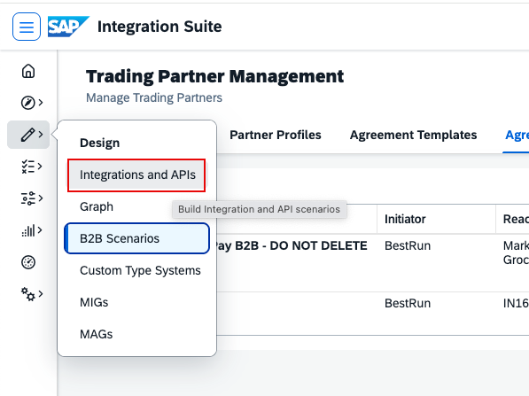
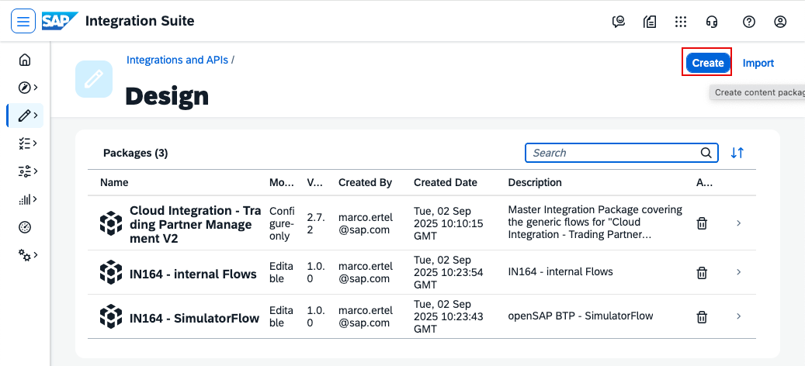
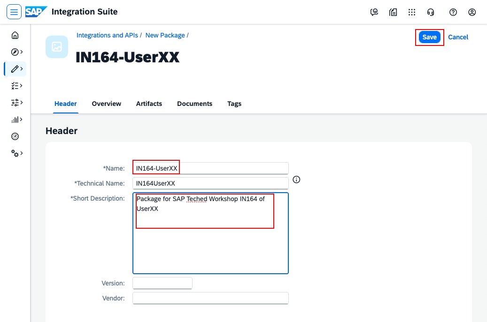
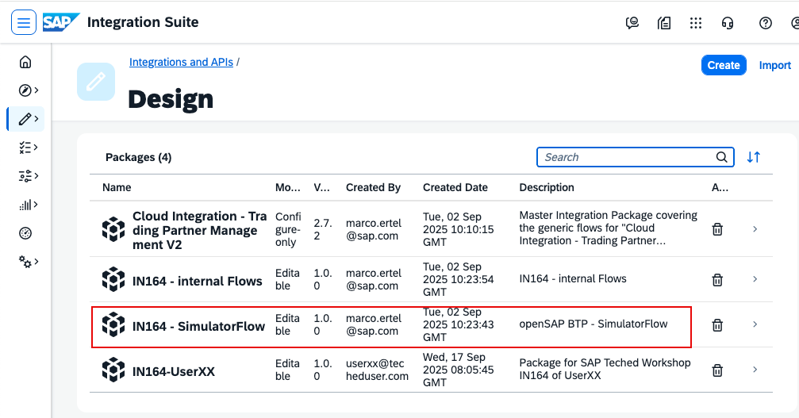
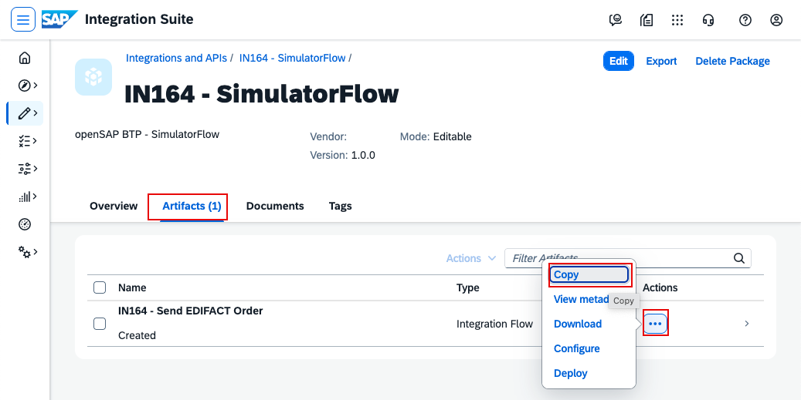
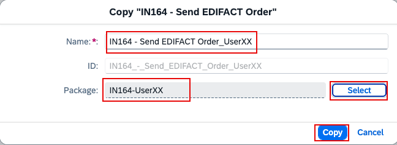
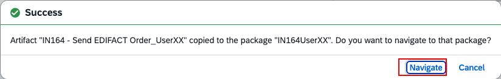
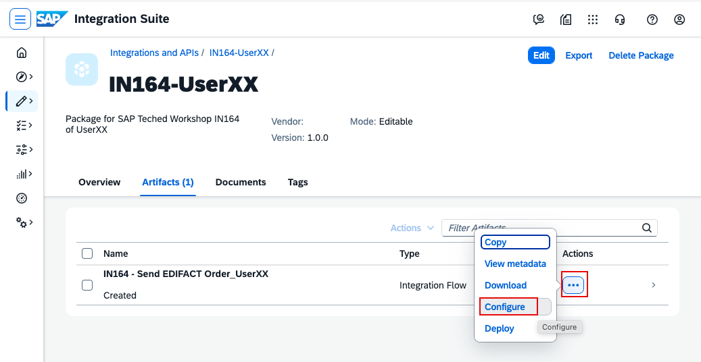
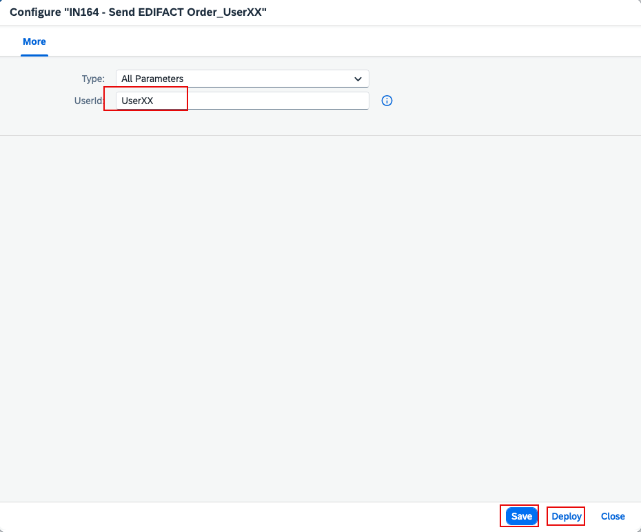
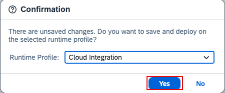

# IN161 - Exercise 2 - Send a test message

## Overview
In this exercise, you will copy an existing iFlow into your own package and configure it to simulate the sending S/4HANA QM system. When deployed, the iFlow pushes a ZQMOUTTC IDoc (the quality certificate) into TPM, which maps it to an ANSI X12 863 message and sends it to your trading partner.
Replace XXX with your participant number wherever it appears.

Go to Design -> Integrations and APIs.

----

Create your own package by clicking Create.

----

Name the package IN161-UserXXX (replace XXX with your number).

----

Navigate to the package IN161-SimulatorFlow.

----

Open the Artifacts tab, click the three dots (...), then click Copy.

----

In the Copy dialog:
- Rename the iFlow to IN161 - Send X12 863_UserXXX (replace XXX with your number).
- Select your package IN161-UserXXX (replace XXX with your number).
- Click Copy.

----

To configure the copied iFlow, click Navigate to open the new iFlow.

----

Open Artifacts, click the three dots (...), then click Configure.

----

In the Configure screen:
- Set UserId to UserXXX (replace XXX with your number).
- Click Save, then Deploy.

----

Confirm the deployment by clicking Yes.
After deployment, the simulated QM system sends a ZQMOUTTC IDoc. TPM maps it to an ANSI X12 863 message and sends it to your trading partner.

----
Continue with: [Exercise 3 - monitor the message](Exercise-3.md)

Please give us feedback for this session **IN161**

