# IN161 - Exercise 2 - Send a test message

## Overview
In this exercise, you will copy an existing iFlow into your own package and configure it to simulate the sending S/4HANA QM system. When deployed, the iFlow pushes a ZQMOUTTC IDoc (the quality certificate) into TPM, which maps it to an ANSI X12 863 message and sends it to your trading partner.
Replace XXX with your participant number wherever it appears.

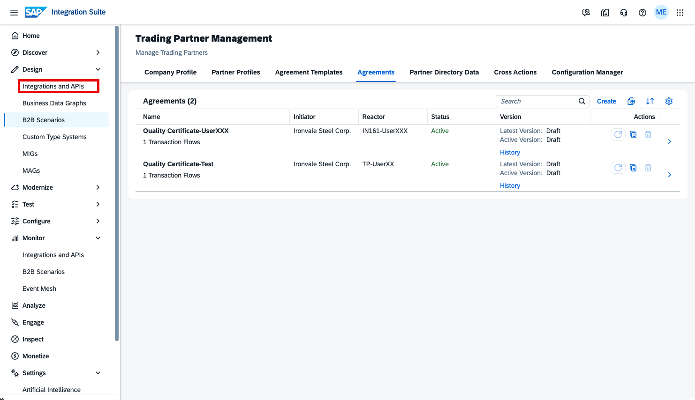

In the left-hand navigation, go to Design -> Integrations and APIs.

----

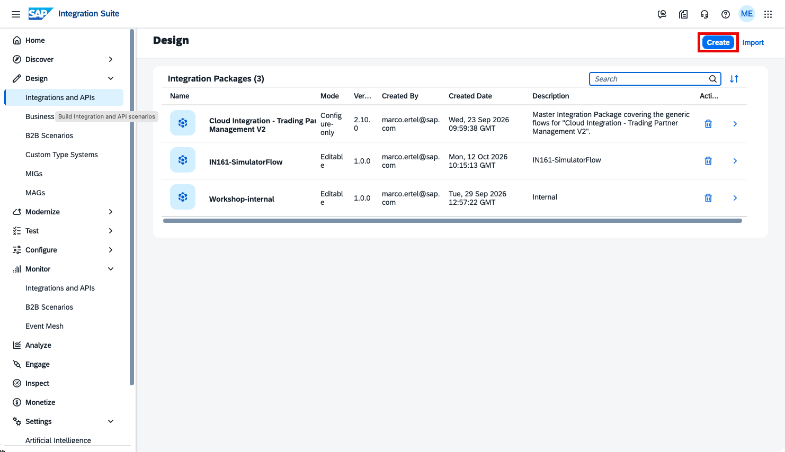

Click Create to create your own integration package.

----

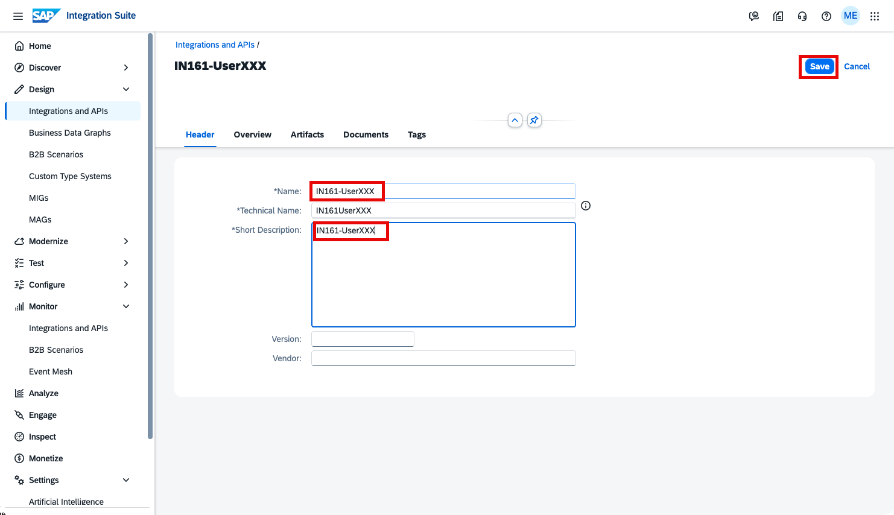

Enter the package name IN161-UserXXX (replace XXX with your number), then click Save.

----

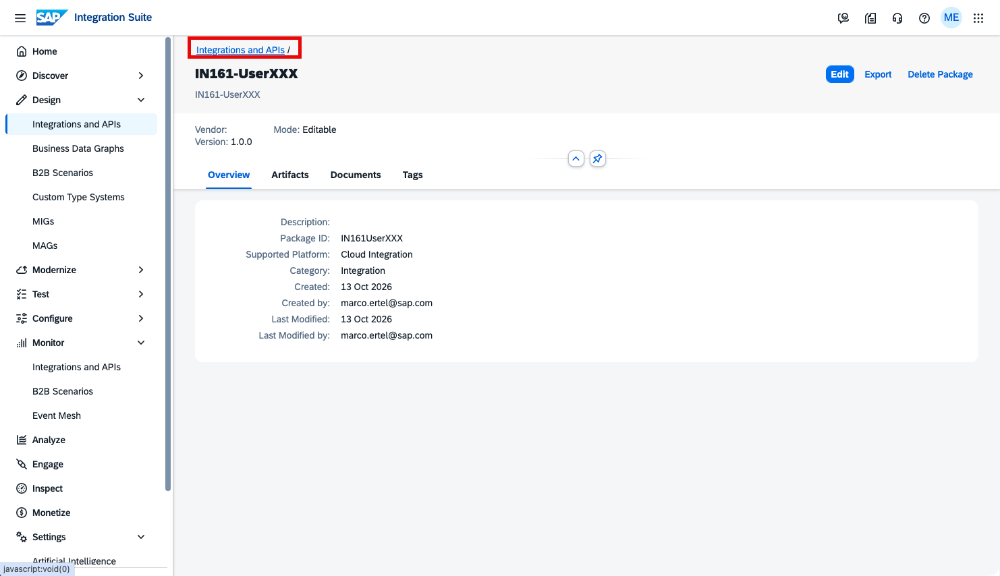

Your package has been saved. Click the breadcrumb link Integrations and APIs to return to the package list.

----

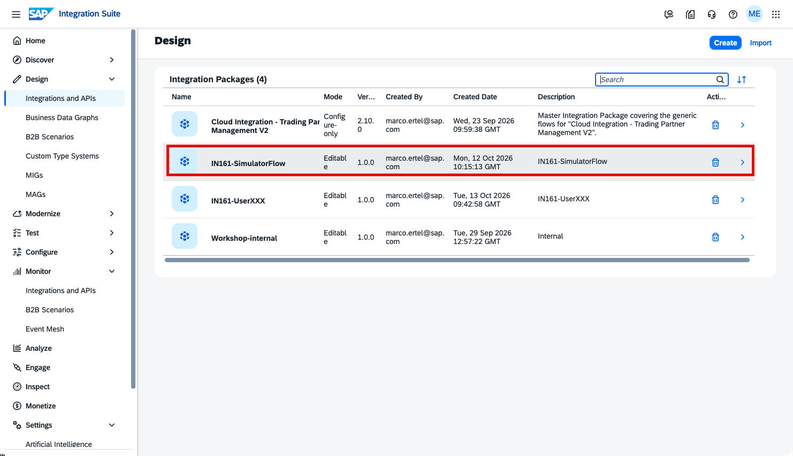

In the package list, click IN161-SimulatorFlow to open it.

----

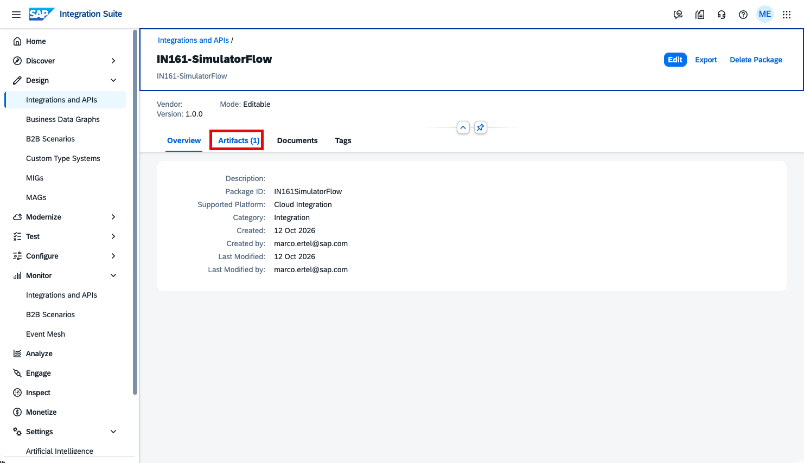

Click the Artifacts tab to see the iFlow contained in the package.

----

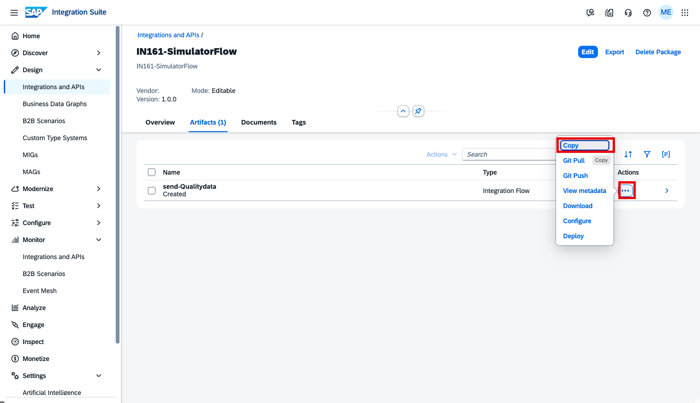

Click the three dots (...) next to the iFlow send-Qualitydata, then click Copy.

----

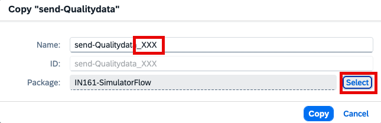

In the Copy dialog:
- Append _XXX to the name so it reads send-Qualitydata_XXX (replace XXX with your number).
- Click Select to choose the target package.

----

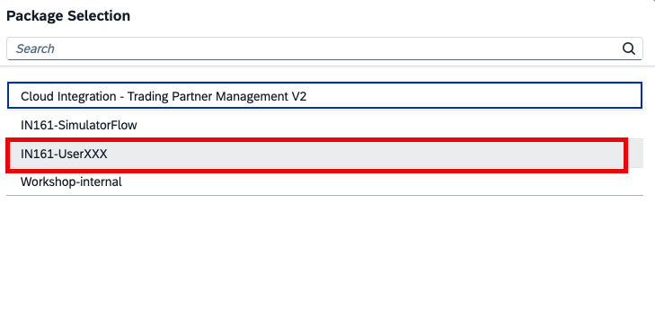

In the Package Selection dialog, select IN161-UserXXX (replace XXX with your number).

----

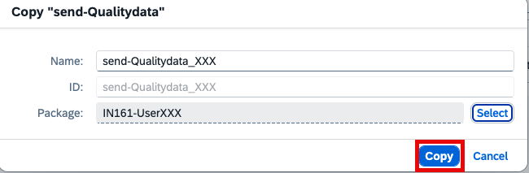

The target package is now set to IN161-UserXXX. Click Copy to copy the iFlow to your package.

----

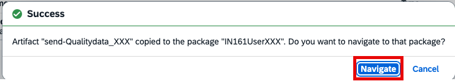

The copy was successful. Click Navigate to open your package IN161-UserXXX.

----

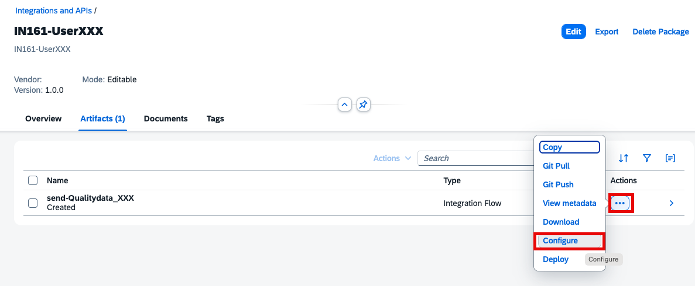

In your package, go to the Artifacts tab. Click the three dots (...) next to send-Qualitydata_XXX and click Configure.

----

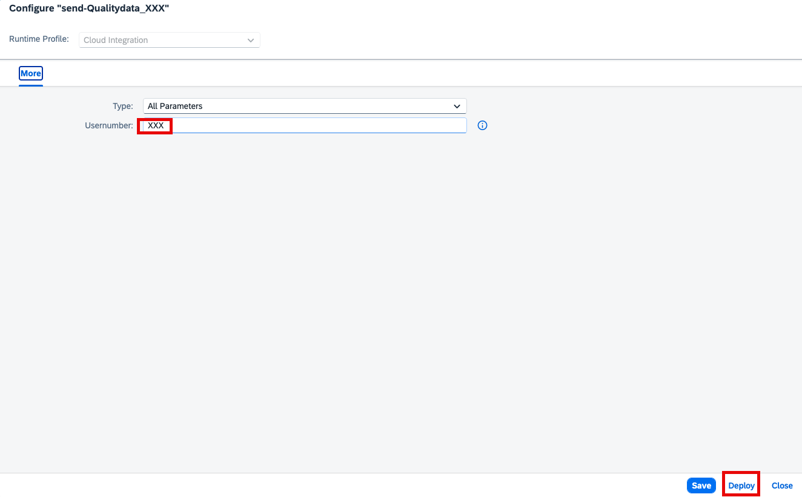

In the Configure dialog, set Usernumber to XXX (replace XXX with your number), then click Deploy.

----

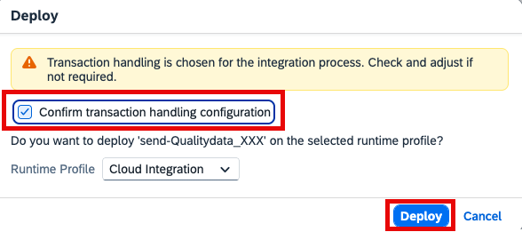

Confirm the deployment by clicking Deploy. If the dialog shows a Confirm transaction handling configuration checkbox, check it first, then click Deploy.

After deployment, the simulated QM system sends a ZQMOUTTC IDoc. TPM maps it to an ANSI X12 863 message and sends it to your trading partner.

----

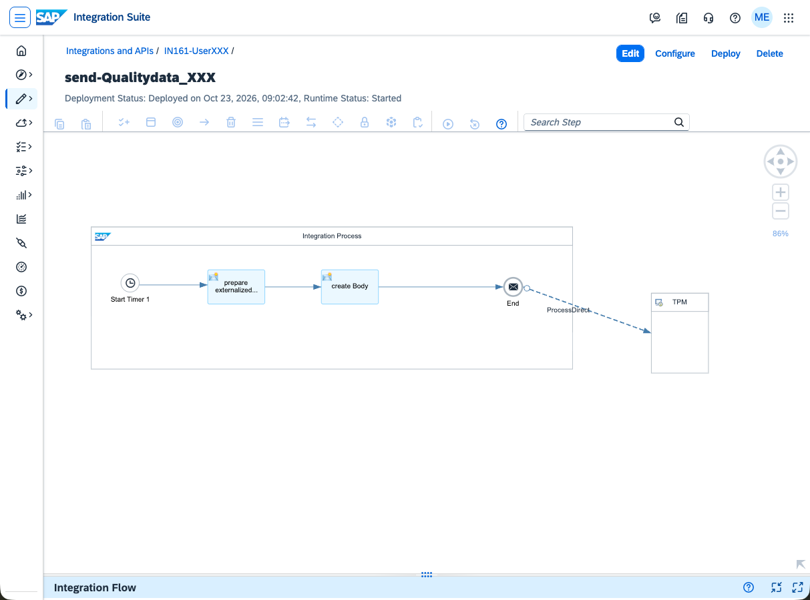

Optionally, open your iFlow send-Qualitydata_XXX to see how it works. The integration process starts with a timer start event that fires once when the iFlow is deployed – that is what triggers the ZQMOUTTC IDoc to be sent, without any manual request. The flow then builds the IDoc payload and hands it over to TPM for mapping and delivery to your trading partner.

----
Continue with: [Exercise 3 - monitor the message](Exercise-3.md)

Please give us feedback for this session **IN161**. Scan the QR code to open the mobile app, then navigate to this session (IN161) to give your feedback.

