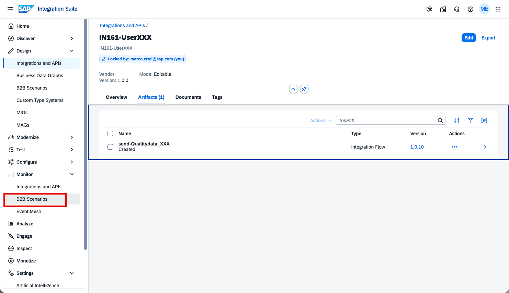
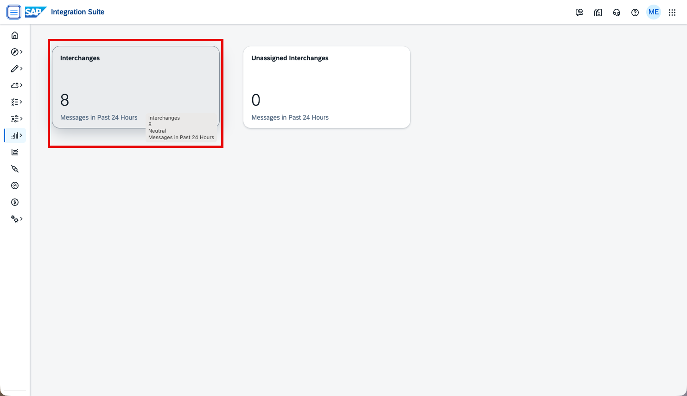
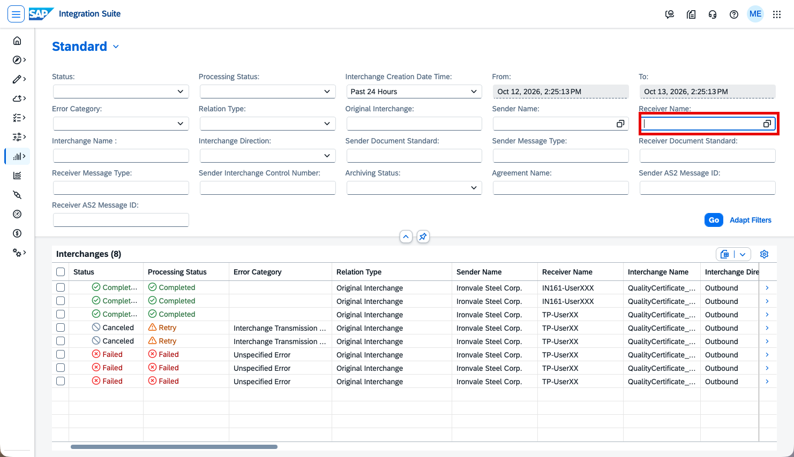
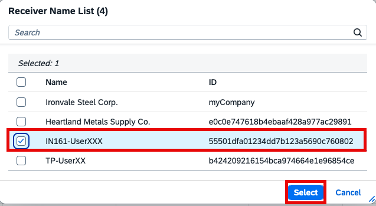
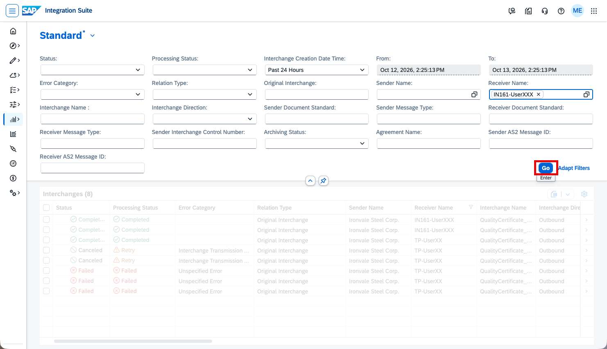
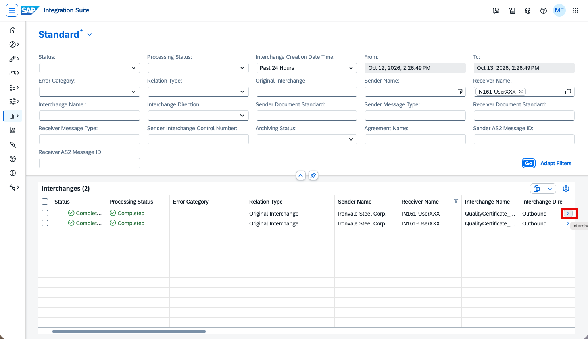
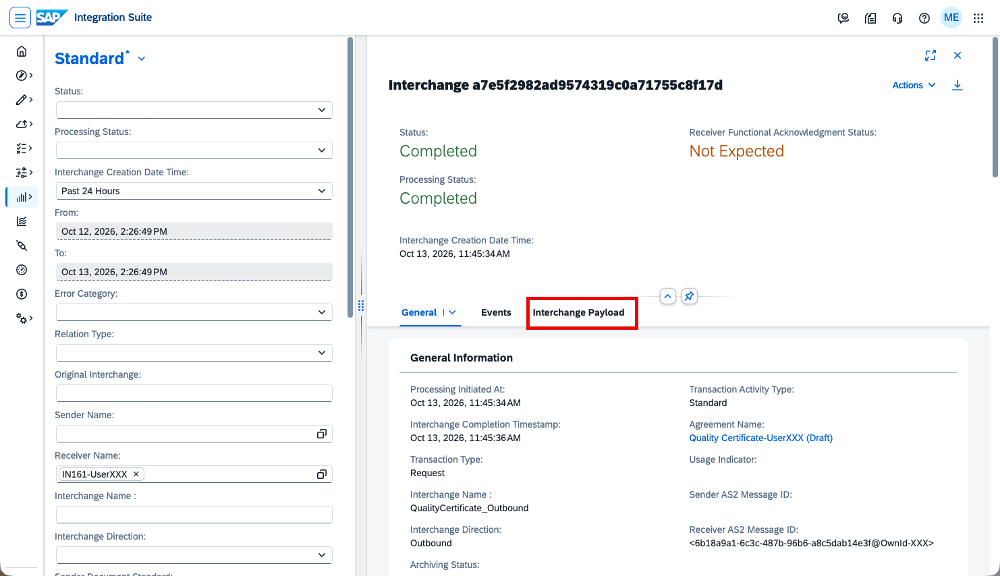
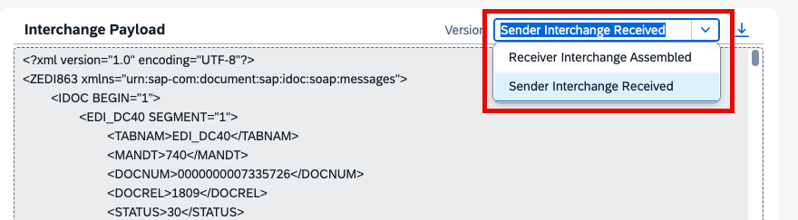

# IN161 - Exercise 3 - Monitor the message

## Overview
In this exercise, you will monitor the outbound ANSI X12 863 message you sent in the previous exercise and inspect both the original IDoc payload and the assembled X12 interchange.

In the left-hand navigation, go to Monitor -> B2B Scenarios.

----

On the B2B Scenarios overview, click the Interchanges tile to open the interchange monitor.

----

The Interchanges list shows all messages processed in the past 24 hours. To narrow the results to your messages, click the Receiver Name filter field.

----

In the Receiver Name List dialog, select IN161-UserXXX (replace XXX with your number), then click Select.

----

Your trading partner IN161-UserXXX is now set as the receiver filter. Click Go to apply the filter. You should see one Completed interchange for each test message you have sent so far. Click the arrow (>) on one of them to open the interchange details.

----

Review the interchange details:
- Status: Completed
- Agreement Name: Quality Certificate-UserXXX
- Interchange Name: QualityCertificate_Outbound
- Interchange Direction: Outbound

Click the Interchange Payload tab to view the message content.

----

Click the highlighted Interchange Payload section to scroll down on this page and view the source and target payloads of the interchange.

----

Use the version dropdown to switch between the two payload versions:
- **Receiver Interchange Assembled** – the outbound ANSI X12 863 that was assembled and sent to your trading partner.
- **Sender Interchange Received** – the original ZQMOUTTC IDoc that arrived from the simulated S/4HANA system.

----

Continue with: [Exercise 4 - onboard the trading partner by copy](Exercise-4.md)

Please give us feedback for this session **IN161**

