# IN161 - Exercise 4 - Onboard the trading partner by copy

## Overview
So far your agreement was created with the **Bind** option. Bind is quick, but it does not let you change the mapping – it always uses the mapping referenced by the template (the one that was migrated from PI/PO). In the next exercises you will build and use your **own Mapping Guideline (MAG)**, and for that you need an agreement created with the **Copy** option.

In this exercise you will therefore **delete** your bind agreement and recreate it from the same template using **Copy from Template**. For now it will still use the migrated PI/PO mapping, so you can confirm it works before you change anything.

As usual, replace XXX with your participant number wherever it appears.

----

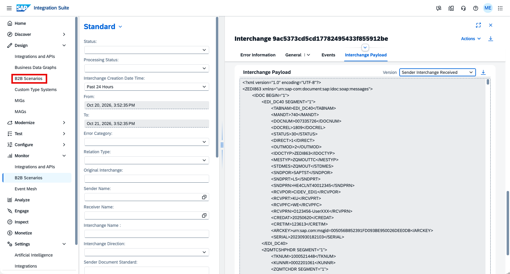

In the left-hand navigation, go to Design -> B2B Scenarios.

----

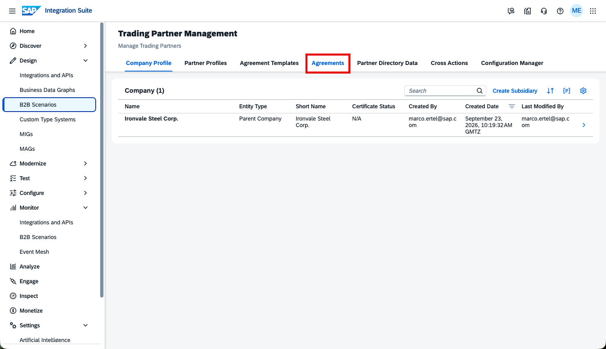

Click the Agreements tab to see your agreements.

----

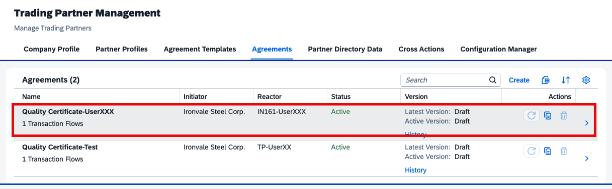

Open your agreement Quality Certificate-UserXXX (the one you created with Bind in Exercise 1).

----

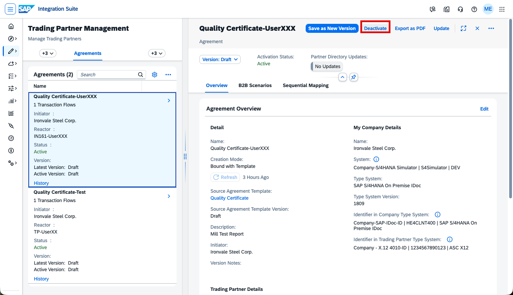

Because you want to replace it, first deactivate it. Click Deactivate.

----

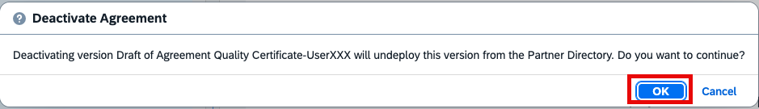

Confirm that you want to deactivate the agreement by clicking OK.

----

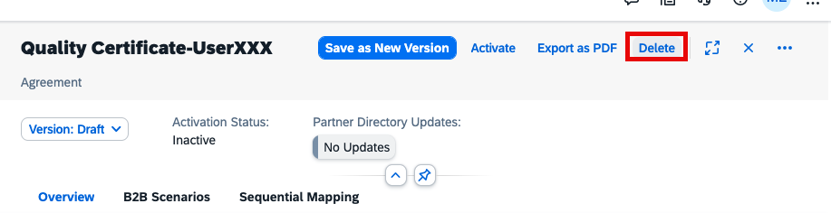

The agreement is now Inactive. Click Delete to remove it.

----

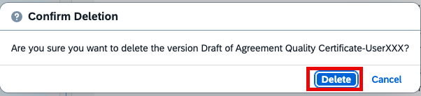

Confirm the deletion by clicking Delete.

----

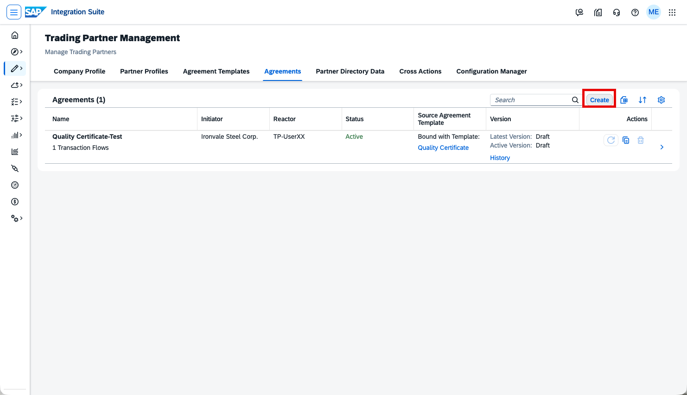

Your agreement has been deleted. Click Create to create a new agreement from the same template.

----

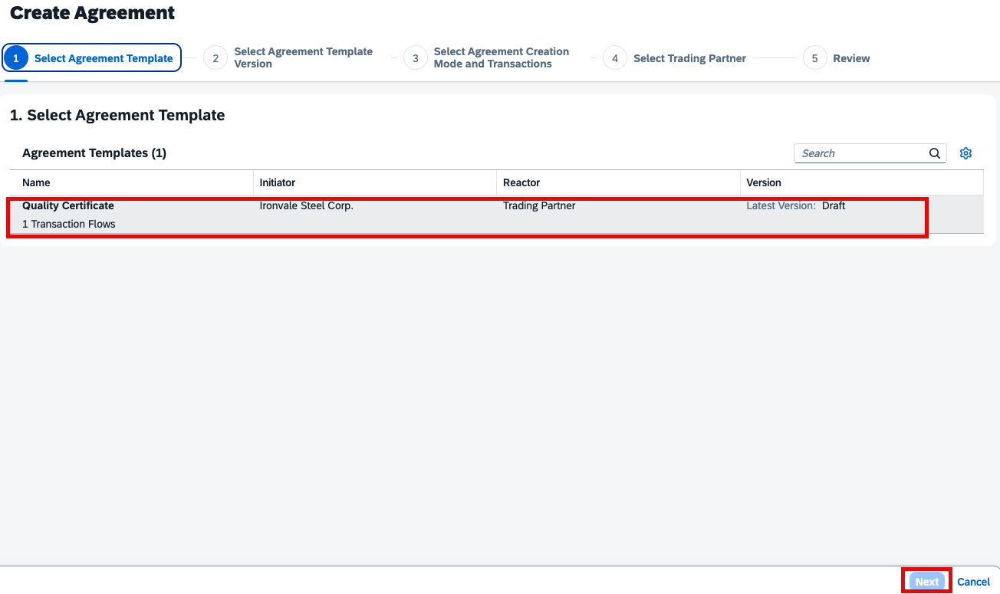

In step 1 of the wizard, select the agreement template Quality Certificate, then click Next.

----

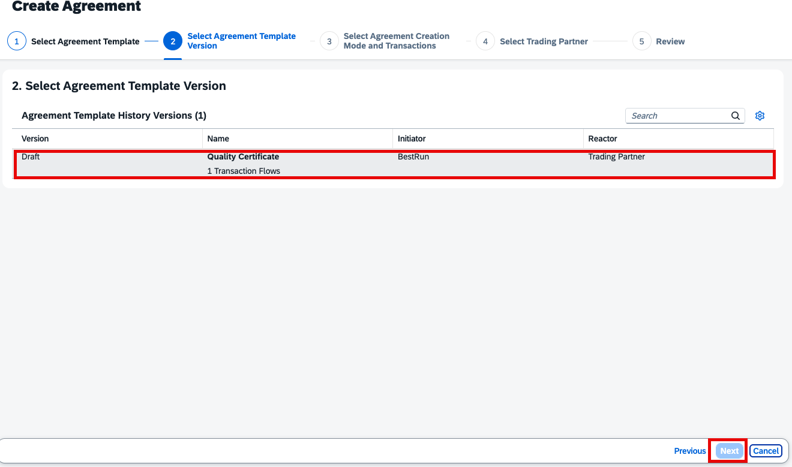

In step 2, select the Draft version, then click Next.

----

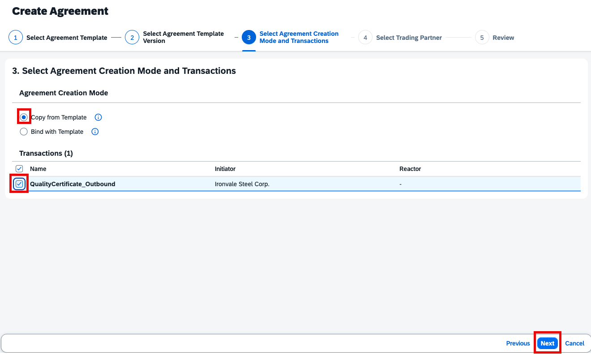

In step 3, select **Copy from Template** as the Agreement Creation Mode (not Bind). Copy creates an independent agreement in which you can later change the MIGs and MAGs. Make sure the transaction QualityCertificate_Outbound is checked, then click Next.

----

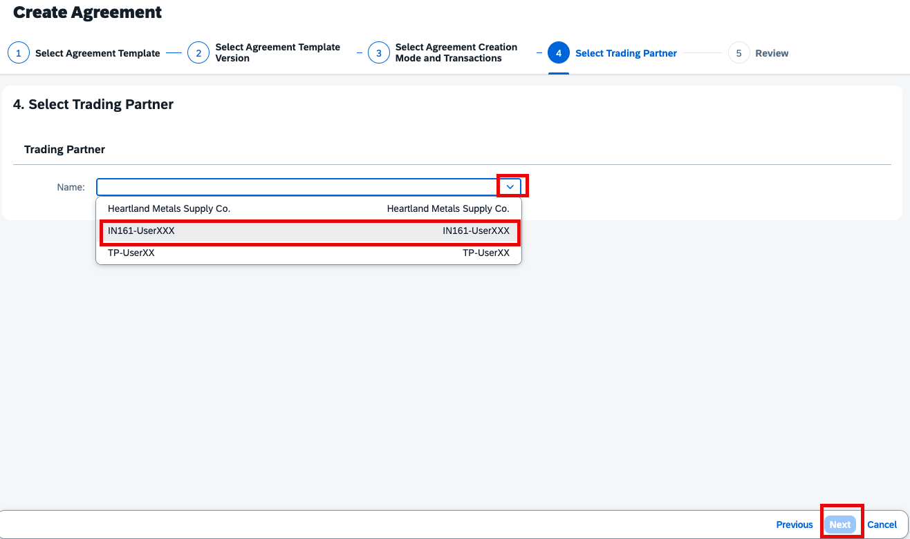

In step 4, open the Name dropdown and select your trading partner IN161-UserXXX (replace XXX with your number), then click Next.

----

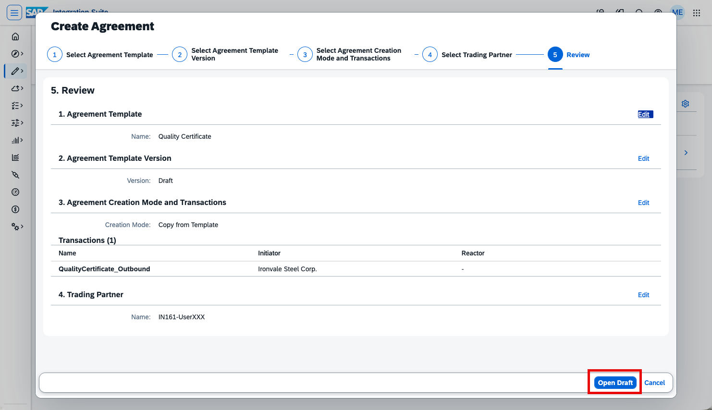

In step 5, review your selections: template Quality Certificate, version Draft, creation mode Copy from Template, trading partner IN161-UserXXX. Click Open Draft.

----

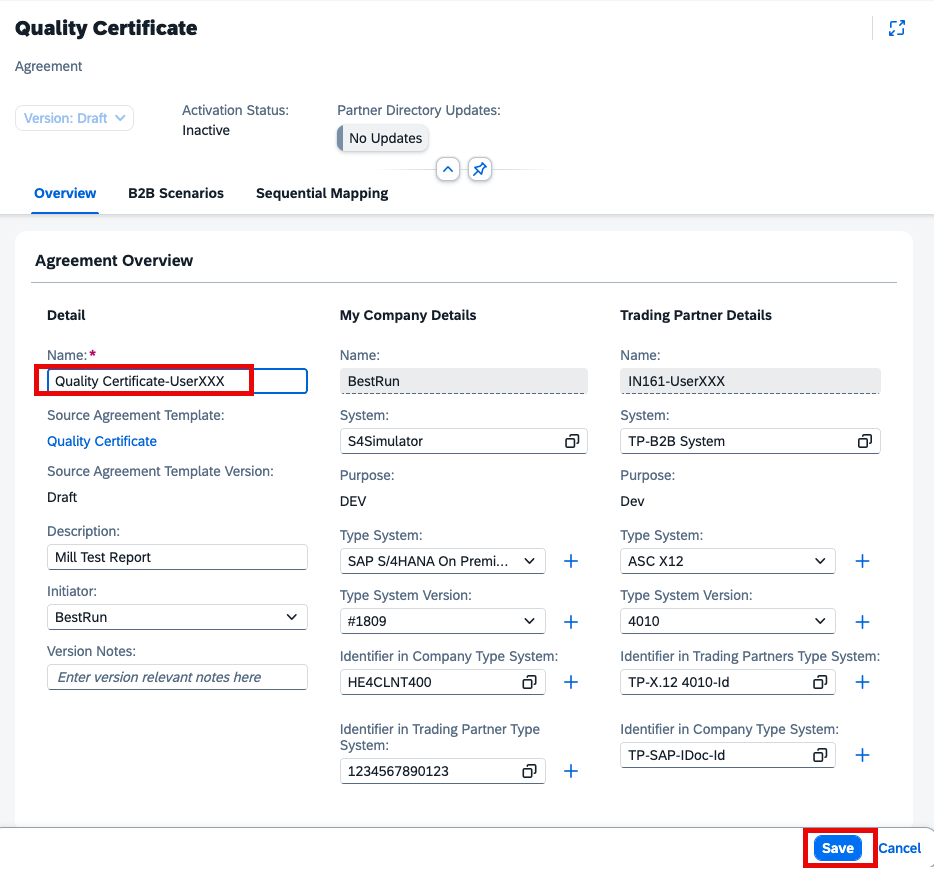

The agreement draft opens. Keep (or adjust) the agreement name to Quality Certificate-UserXXX (replace XXX with your number), then click Save.

----

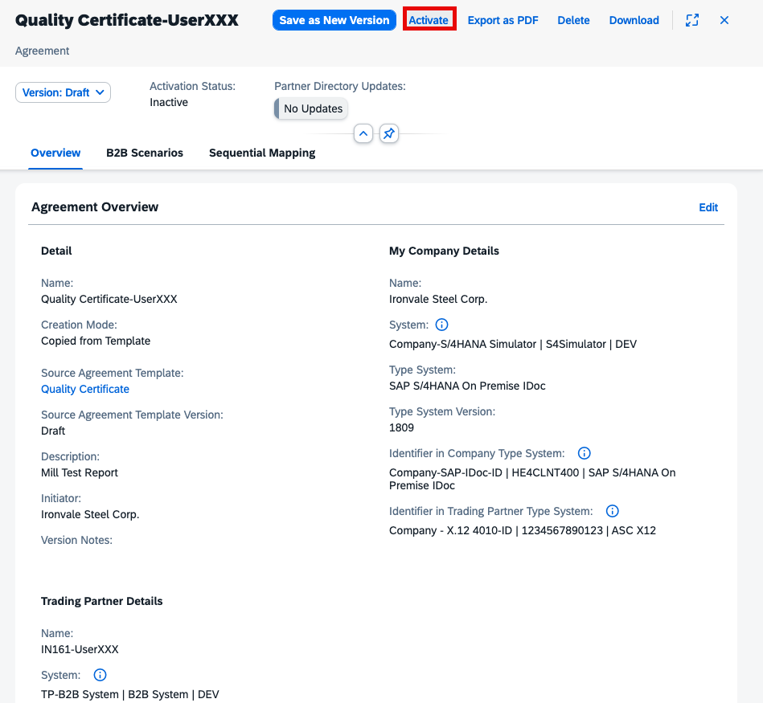

Click Activate to deploy the agreement to the Partner Directory.

----

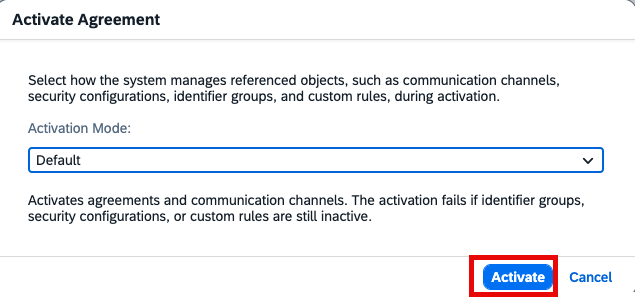

In the Activate Agreement dialog, keep the Activation Mode on Default and click Activate.

----

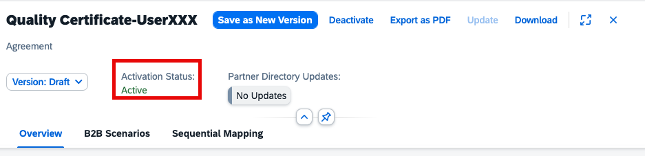

The Activation Status now shows Active. Your copied agreement is live and ready.

----

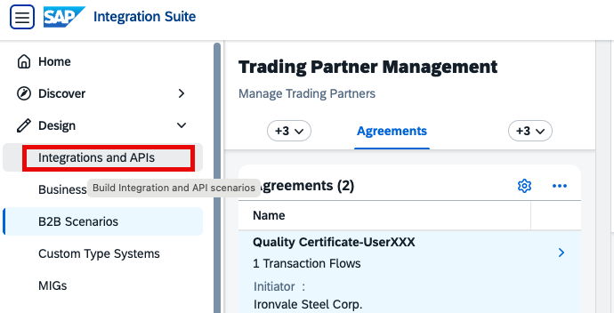

To verify that the copied agreement works, send a test message. In the left-hand navigation, go to Design -> Integrations and APIs.

----

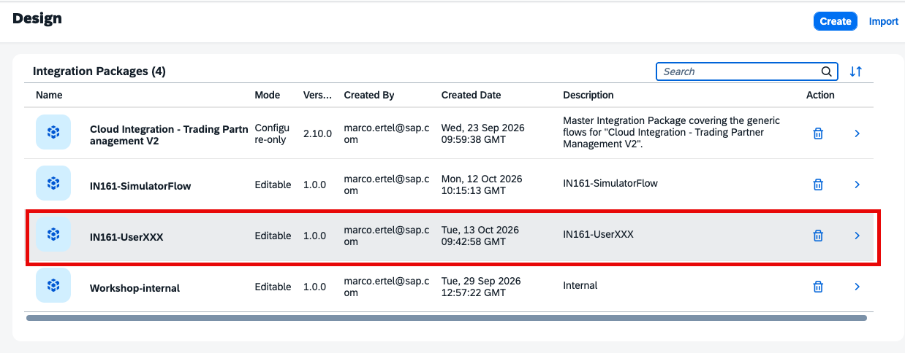

Click your package IN161-UserXXX to open it.

----

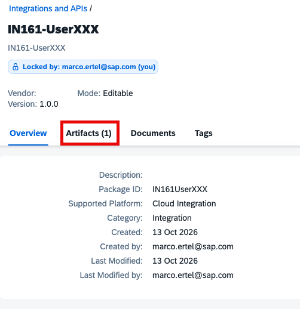

Click the Artifacts tab to see your iFlow.

----

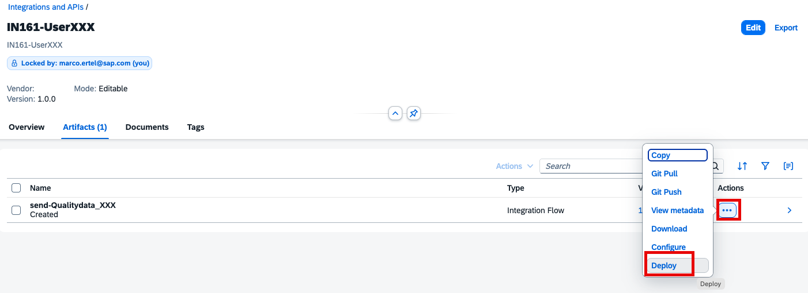

Click the three dots (...) next to send-Qualitydata_XXX and click Deploy.

----

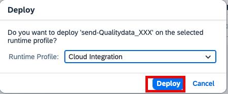

Confirm the deployment by clicking Deploy. If the dialog shows a Confirm transaction handling configuration checkbox, check it first, then click Deploy.

After deployment, the simulated QM system sends a ZQMOUTTC IDoc. Go to Monitor -> B2B Scenarios -> Interchanges, filter by your Receiver Name IN161-UserXXX, click Go, and confirm you can see a new Completed outbound interchange.

----

Continue with: [Exercise 5 - (Optional) Create Target Message Implementation Guideline](Exercise-5.md)

Please give us feedback for this session **IN161**

