# IN161 - Exercise 5 - Create your own Mapping Guideline (MAG) using proposals

## Overview
Until now, your agreement has used the mapping that was **migrated from PI/PO** and was already available in the tenant. That is the fastest way to go live, but you often want to own and evolve the mapping yourself in Integration Advisor.

In this exercise you will create your **own Mapping Guideline (MAG)** that maps the SAP IDoc **ZQMOUTTC** (quality certificate) to the **ANSI X12 863** (Report of Test Results). Instead of mapping every field by hand, you will let the Integration Advisor **knowledge base propose** the mapping for you. Finally, you will plug your new MAG into your Copy agreement, send a message, and verify the result in the B2B Monitor.

The source and target Message Implementation Guidelines (MIGs) already exist in the tenant:
- Source MIG: _QM-863 SAP IDoc ZQMOUTTC - Source_
- Target MIG: _QM-863 ANSI X12 004010 863 - Target_

As usual, replace XX with your participant number wherever it appears.

----

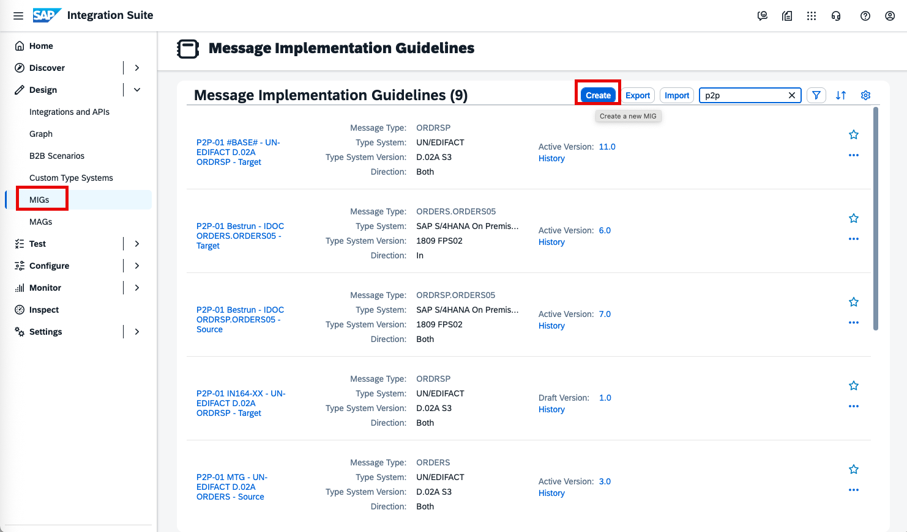
In the left-hand navigation, go to Design -> MAGs.

----

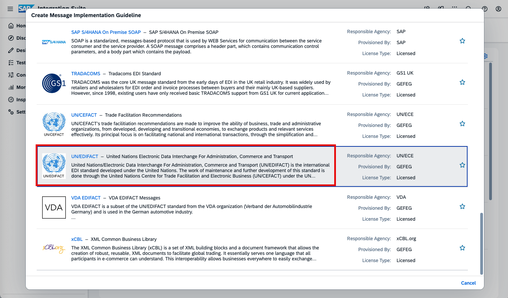
Click Create -> MAG.

----

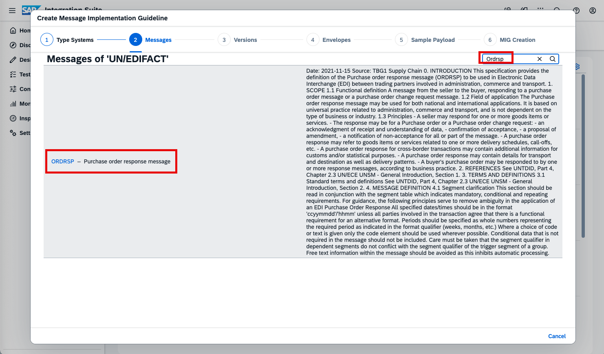
Select the source MIG: _QM-863 SAP IDoc ZQMOUTTC - Source_.

----

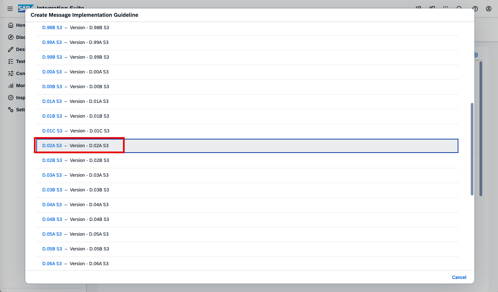
Select the target MIG: _QM-863 ANSI X12 004010 863 - Target_.

----

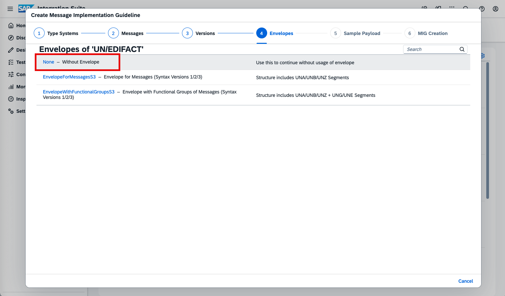
Enter the MAG name using the following naming scheme: _QM-863 IN161-XX ZQMOUTTC-to-ANSI X12 004010 863_ (replace XX with your number), then click Create.

----

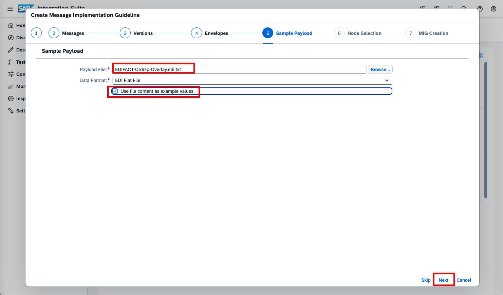
Your new MAG opens in the mapping editor. It is still empty – no fields are mapped yet. To avoid mapping everything manually, request a proposal from the knowledge base: click _Proposal_.

----

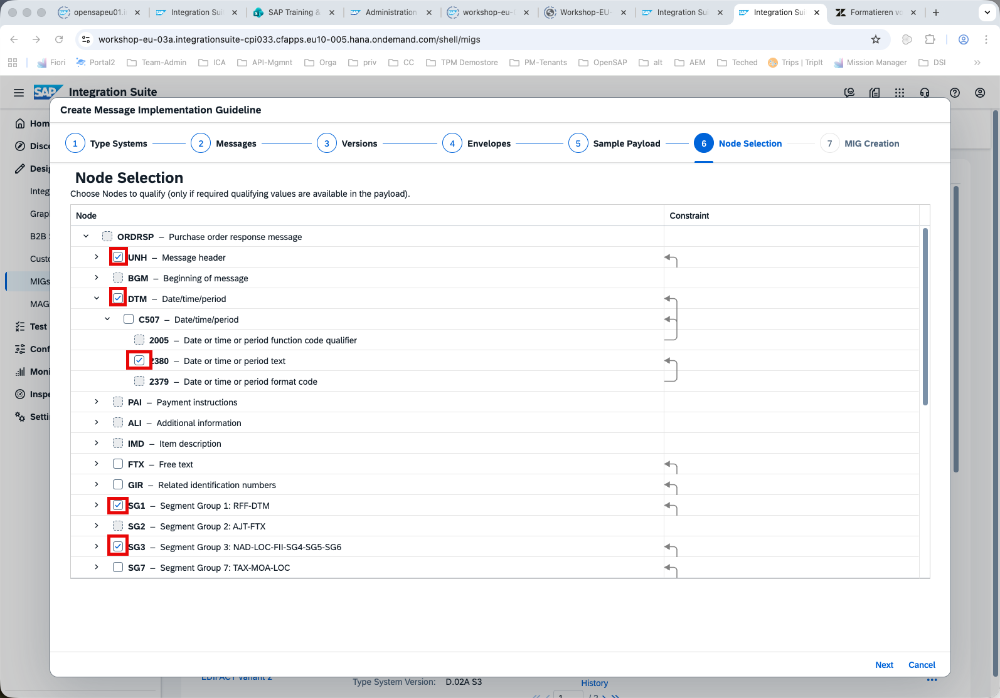
To automatically apply the proposal with the highest confidence, click _Select Best Proposal_.

----

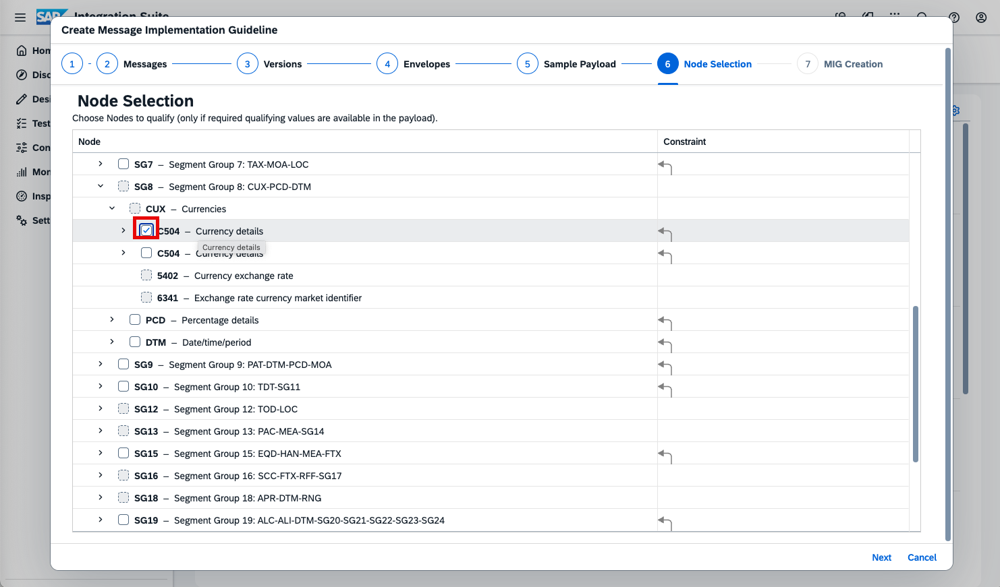
Because the knowledge base can include mapping functions that may not work in your context, select _Use Only Valid Mappings_ to exclude non-working snippets.

----

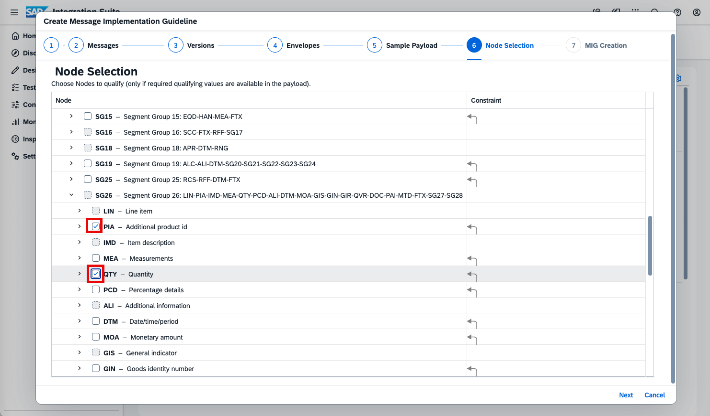
Review the proposed mappings. The knowledge base maps the quality-relevant fields (for example, inspection/test values and their units) from the ZQMOUTTC structure to the corresponding X12 863 segments. Then click _Save_.

----

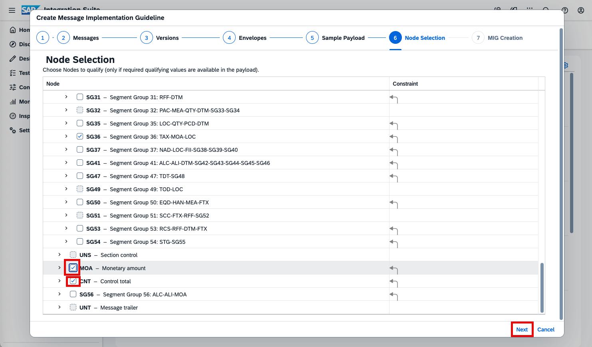
You should see a success message confirming that your MAG has been created and saved.

----

Now use your new MAG in your agreement.

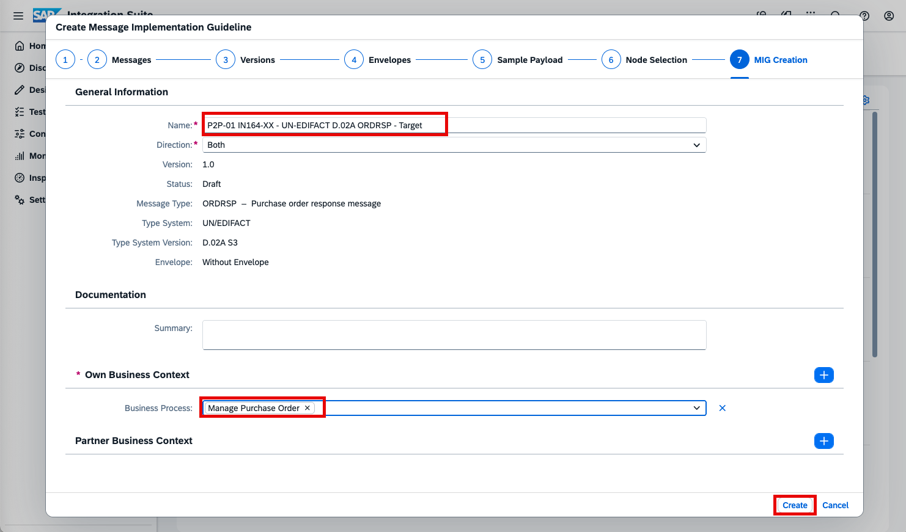
In the left-hand navigation, go to B2B Scenarios -> Agreements. Open your agreement IN161-UserXX-copy (replace XX with your number). It should be _Active_ from the previous exercise.

----

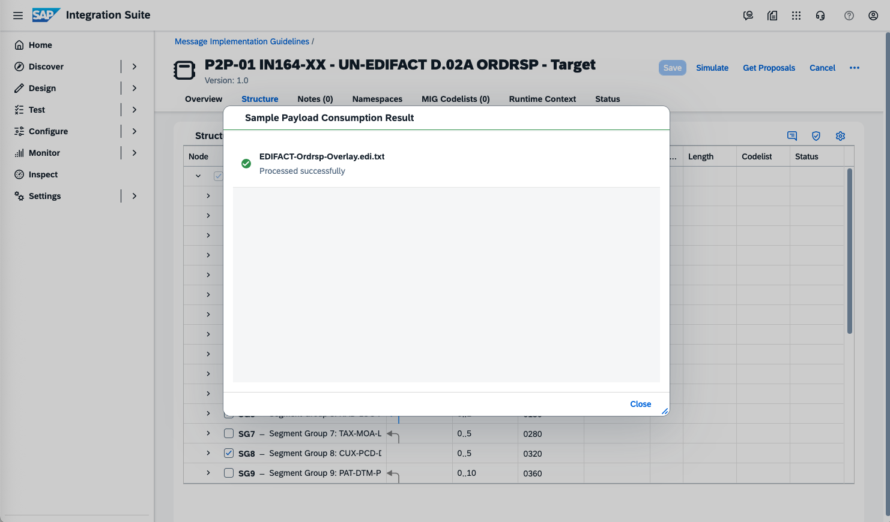
Switch to the B2B Scenarios tab and set the B2B Scenario to _Edit_ mode. In the Report of Test Results transaction flow:
- Click the _Mapping_ box.
- In the details pane, click the _Mapping_ field to open the selection dialog.
- Search for IN161 and select your MAG: _QM-863 IN161-XX ZQMOUTTC-to-ANSI X12 004010 863_ (replace XX with your number), then click _Choose_.

----

Click _Save_ on the agreement, then click _Update_ to write the changes to the Partner Directory. Wait until the extraction of runtime data is complete and the agreement returns to _Active_.

----

Send a test message: go to Design -> Integrations and APIs -> IN161-UserXX, open _Artifacts_, click _More_ (...) -> _Deploy_. Then go to Monitor -> B2B Scenarios -> Interchanges, click _Go_, and open your outbound interchange to confirm the ANSI X12 863 message was produced by your own MAG.

----

Continue with: [Exercise 6 - Enhance the mapping with Joule](Exercise-6.md)

Please give us feedback for this session **IN161**

