# IN161 - Exercise 5 — (Optional) Create the target Message Implementation Guideline (MIG)

## Overview

**Prerequisite**: Download the sample payload [X12-863.txt](Payload/X12-863.txt) from the Payload folder.

In this exercise you will create the trading-partner-specific target MIG. Creating and designing a MIG involves:

  - creating the target message structure easily from an existing EDI payload, and refining the nodes – especially their qualification,
  - defining the properties of leaf nodes, such as length, cardinality, format, and primitive type,
  - creating and assigning code lists, and customizing elements at the leaf-node level.

Adding human-readable descriptions and setting integrity conditions via assertions enrich the MIG semantically. The more precise you are when finalizing your MIG, the easier the later mapping steps – and the life-cycle management of the artifacts involved – become.

You do not have to prepare everything mentioned above. We simply want to show you the most important steps to consider when building Message Implementation Guidelines for your future projects.

<u>Let's start by creating the X12 message from a payload:</u>

Go to the Message Implementation Guidelines overview screen and, from the Create button dropdown, select the "Create by Payload" option.
 

----
Drop in or select the prepared payload and work through the guided steps, confirming the proposed selection for the X12 type system and the 863 message with version 004010. 
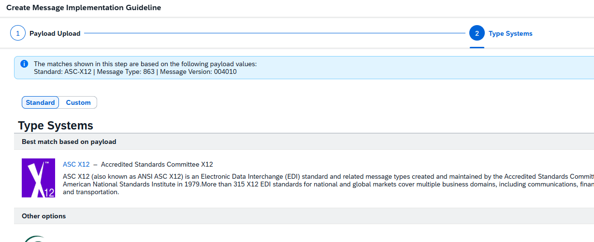

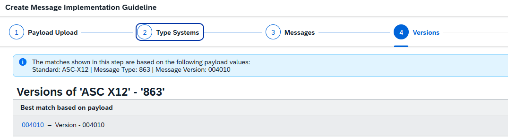 

----
Select Envelope and navigate to the "Sample Payload" selection step.
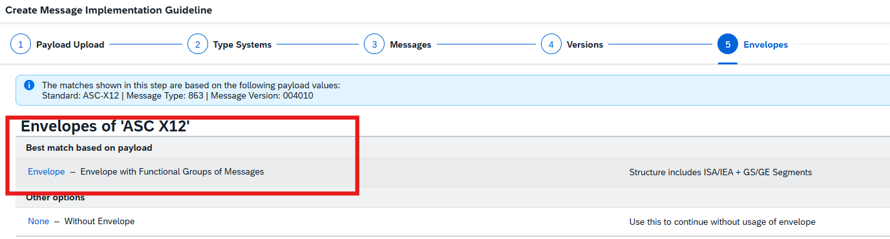 

----
Select all offered options, including "Set Example Values", as shown in the screenshot.
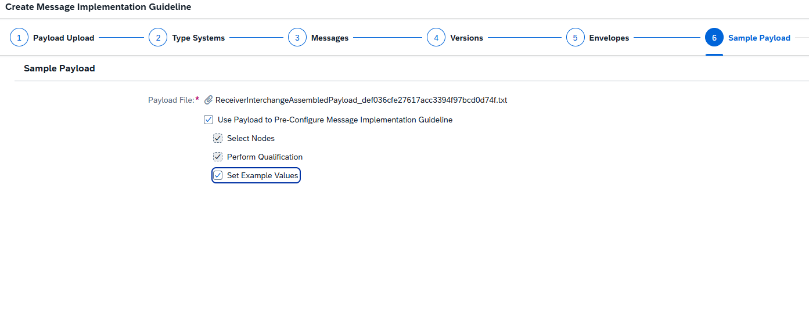 

----
Go to the Qualification step and select the nodes as shown in the screenshot.
 

Click the Create button in the lower-right corner. The MIG Creation dialog opens, where you specify the name and direction of the MIG as well as the business context information.
Specify:
 	MIG Name: UserXXX - 863 - Target MIG (replace XXX with your number)
 	Direction: Out
Own Business Context: select the country Germany (one entry is enough). 
 

----
<u>Now let's refine the MIG using the built-in accelerator features such as the proposal service, qualification, and more.</u>

Now that your Message Implementation Guideline is based on the **863** message, you select the fields relevant to your scenario and build the MIG accordingly. The application can also propose which fields are likely most relevant for you, based on existing MIGs.
A few things to keep in mind before you work with a MIG:
- In the MIG structure, a node whose checkbox is selected is a mandatory element as defined by the original message template.
- To edit details of a node (Name, Simple Type Properties, Description, and so on), you must select that node's checkbox.
- You can keep the qualifier markers defined by the source template, and add your own: select an element that can be qualified, edit its property sheet, and maintain the instance by selecting the qualifier values. 

Navigate to the second tab, "Structure", and click the "Get Proposal" button in the upper-right corner.
 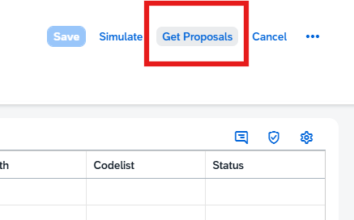 

> **Note:** Qualifier values will be taken over from the payload. In case you do not see them as shown in the screenshots, you may need additional steps to assign those enumerations to the required node — for example, setting qualifier markers to enable qualification with scenario-specific values.

----
In the Structure, a new "Confidence" column with blue bars appears next to the proposed nodes (for example, **ST** under **863**).
Navigate to the node **ST**, use the qualify action (the two-boxes icon), and select the proposed qualification value _863_ to qualify the **ST** segment from element **143** _Transaction Set Identifier Code_. This is a constant qualification that is taken over automatically in the mapping exercise.
  
   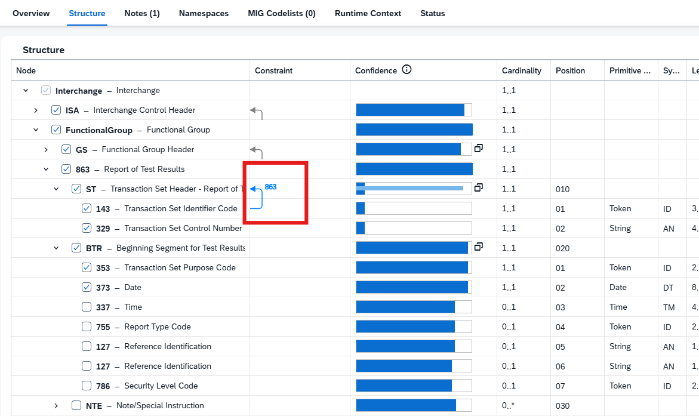 

----
In SAP Integration Advisor MIGs (Message Implementation Guidelines), qualifying EDI structure nodes is one of the most powerful modeling techniques, because it adds business meaning (semantics) directly into the message structure instead of leaving that interpretation to the mapping runtime. The message structure is composed of logically related pieces of information grouped into generic data segments. You can precisely specify the context of generic elements in your MIG to give business meaning to the rest of the data in a segment.

To do so navigate to the element **BTR**, then navigate to the node **353** and double-click the node to see the Details panel on the right.
Navigate to the section **Qualifier Markers**, select the **+** button and add a marker to **BTR** by clicking **Create**. 
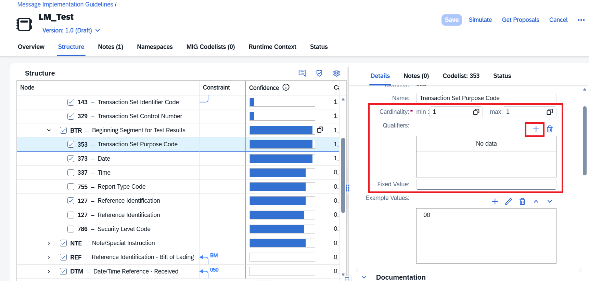 

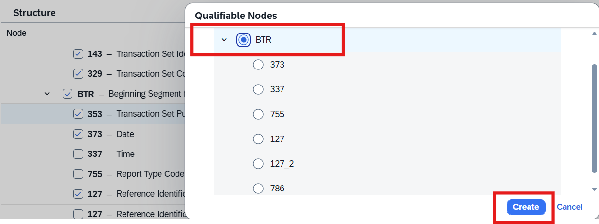 

Once this is done, use the qualify action (the two-boxes icon) and select the proposed qualification value _00_.
 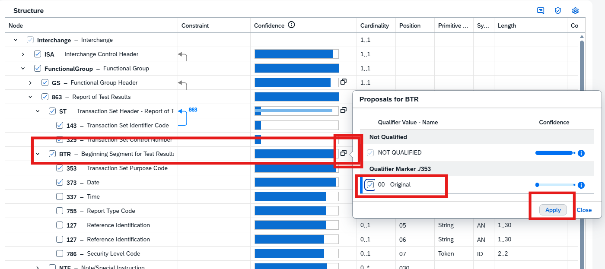 

----
Repeat the same activity for the element below.

Navigate to element **PID**, use the qualify action (the two-boxes icon), and select the proposed qualification value _F_.
 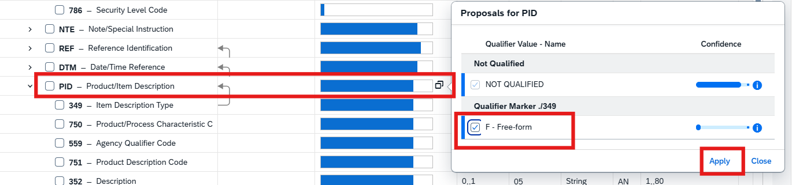 

----
To give a bit more insight into why qualification matters: a generic, repeatable group of segments such as **N1** can hold name, address, or reference information. At the semantic level it is unclear which type of name or address the message refers to, so additional information is needed to remove this ambiguity. Qualifiers let you specify which type of repeatable segment – for example a name or an address – is stored in a particular instance of a data segment. 

An address segment generally consists of a similar set of fields, such as street, city, state, postal code, and country. However, there may be more than one kind of address, such as a delivery address, a contact address, or a billing address. In these situations you can use a common address segment structure and then use a qualifier to specify which type of address is stored in a particular instance. 

Qualifiers are provided by a leaf node (the qualifying node) in the form of code lists and related code values – in our example, **BY** = **Buyer** or **ST** = **Ship To**.
 A leaf node can qualify a group node or another leaf node (a peer node) only if it has a code list assigned to it. The link between the qualifying node and the node you want to qualify (the qualifiable node) is shown by a gray qualifier marker arrow. A qualifier marker can point from a qualifying element to a parent group element or to a peer element at the same level, and helps identify which elements can be qualified. Qualifier markers are either provided automatically by the message templates of the type systems, or you can create your own to suit your business context. 
A qualified group or peer leaf node is indicated by a blue arrow marker from the qualifying leaf node to the qualified node, together with the qualifier value from the selected code values. The name of the qualifier value is appended to the qualified instance. 

----
<u>Now let's refine the semantic meaning of the **N1** element by qualifying its multiple occurrences.</u>

Navigate to element **N1**, use the qualify action (the two-boxes icon), and select the proposed qualification value _ST_.
 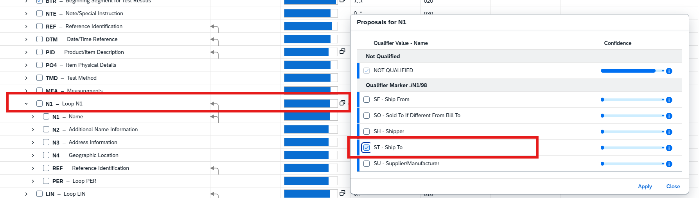 

----

A qualified **N1** element with the value _ST_ has been created. Because we need several **N1** segments, we qualify two more elements: _SE_ for the selling party and _BY_ for the buyer party. This qualification enables a direct mapping of the source elements from the IDoc structure to the target structure, without any additional functional mapping steps.
To qualify another value for the **N1** segment, duplicate the node: right-click the qualified **N1**, choose _"Duplicate Qualified Node"_, and select the value _"SE"_, as shown in the screenshot.

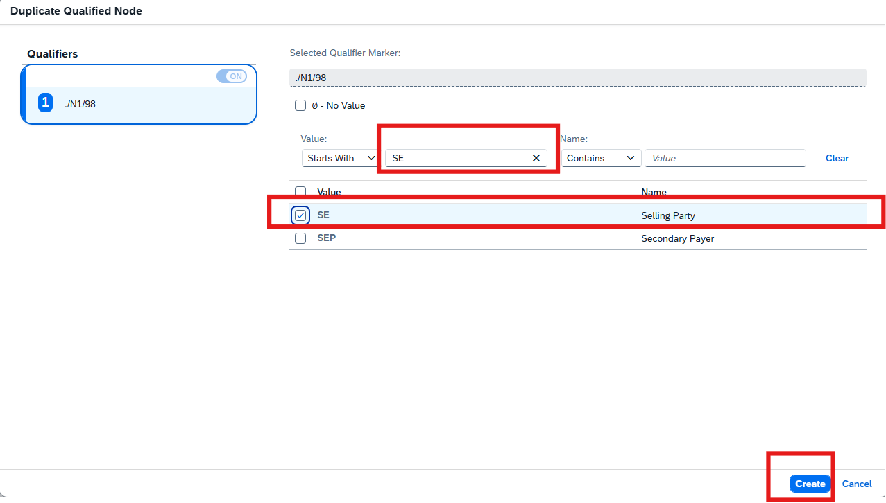 

----

Do the same again for the newly created **N1** node: right-click the qualified **N1**, choose _"Duplicate Qualified Node"_, and select _"BY"_.
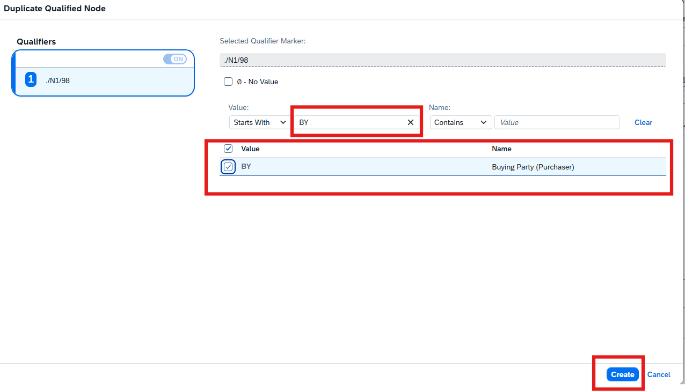 

----
Next, navigate to element **DTM**, right-click it, and select _"Qualify Node..."_.
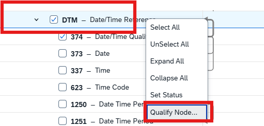 

----
Select the value _"050"_ from the enumeration list and click **"Create"** to qualify the **DTM** segment.

Once you have verified the actions, you can filter the view to the selected elements: open the filter on the first column, **Node**, and set it to _"Show Selected Nodes"_.
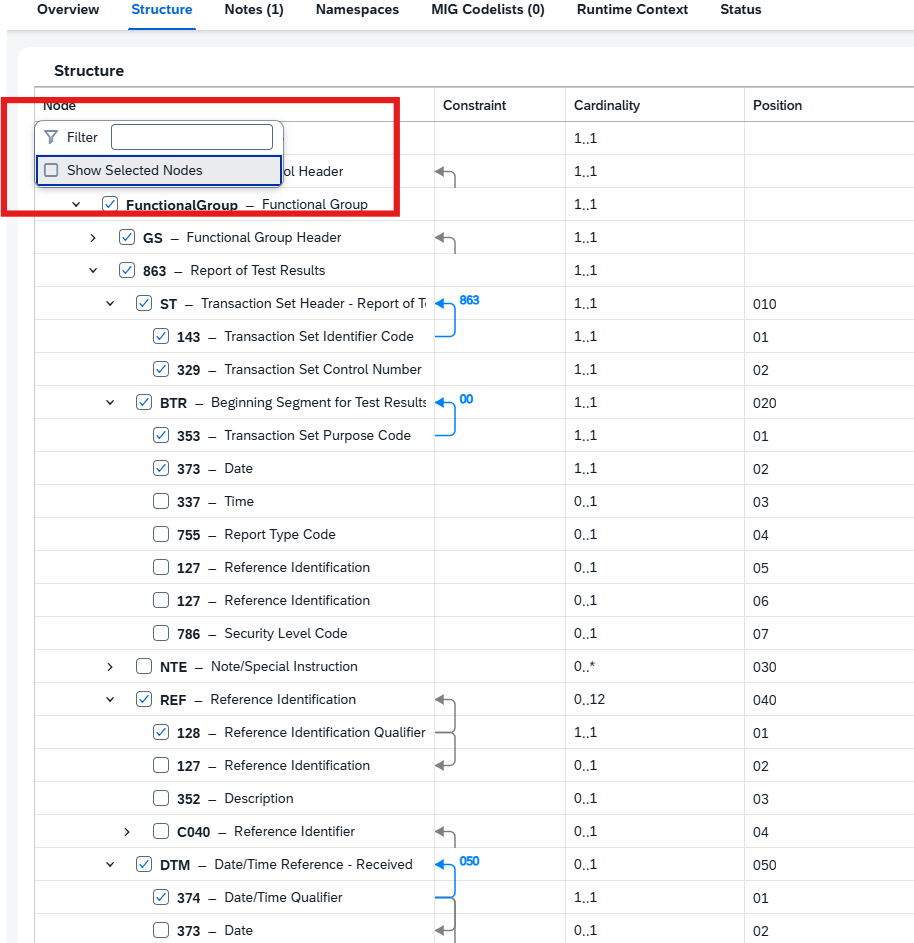 

----
To check whether the payload content is represented correctly, run a simulation in the MIG using either the inserted example data or your uploaded payload:
(a) In the MIG main menu, choose Simulate → _"Simulate with MIG Example Data"_.
(b) You will see all the example values at the corresponding leaf nodes.
(c) When you are satisfied with the result,

click the **"Save"** button to save your changes.

**In summary:**
The single most important takeaway is node qualification in Integration Advisor.
<u>It is powerful because it:</u>

- removes ambiguity from repeated segments,
- improves semantic matching during MAG generation,
- eliminates many conditional mapping rules and filters.

Every qualifier you identify and model in the MIG is one less conditional mapping function to build and maintain later.

Continue with: [Exercise 6 - Create your own Mapping Guideline (MAG) using proposals](Exercise-6.md)

Please give us feedback for this session **IN161**. Scan the QR code to open the mobile app, then navigate to this session (IN161) to give your feedback.

