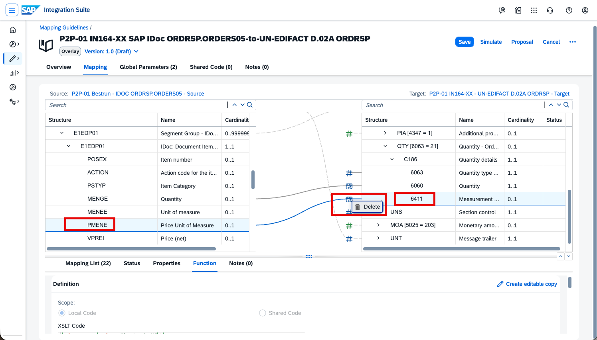

# IN161 - Exercise 6 - Enhance the mapping with Joule

## Overview
Your MAG from Exercise 5 already covers the fields that the knowledge base could propose. In real life, however, some target fields in the ANSI X12 863 need transformations that a plain field-to-field proposal cannot provide – especially in the steel industry, where test values, units, and material grades often have to be reformatted or translated to the partner's conventions.

In this exercise you will use **Joule**, the generative-AI copilot, to create such **mapping functions** from a simple natural-language description, instead of writing the logic by hand.

Typical examples in our Report of Test Results scenario:
- Combine a measured value with its unit of measure into one formatted string (for example, `355 MPa`).
- Convert an internal unit of measure to the code the partner expects.
- Map an internal steel-grade / material code to the trading partner's code list.
- Derive a pass/fail indicator by comparing a measured value against its specification limits.

As usual, replace XXX with your participant number wherever it appears.

> Note: Joule assistance in Integration Advisor must be enabled for the tenant and may depend on your data center region. If you do not see the Joule option, ask your trainer.

----

In the left-hand navigation, go to Design -> MAGs and open your MAG from the previous exercise: _QM-863 UserXXX ZQMOUTTC-to-ASC X12 004010 863_ (replace XXX with your number).

----

In the mapping editor, locate the target field in the X12 863 that needs a transformation (for example, the field that should contain the measured test value together with its unit). Select the field to open its mapping details.

----

Open _Joule_ from the mapping editor.

----

Describe the transformation you need in plain language, for example:

> "Concatenate the measured value and its unit of measure, separated by a space, and return the result as a single string."

Then let Joule generate the mapping function.

----

Review the mapping function that Joule proposes. Check that it uses the correct source fields and produces the expected output. If it is not quite right, refine your description and let Joule regenerate it.

----

Apply the generated function to the target field, then test it with example values to confirm the output is correct.

----

Optionally, repeat the process for another transformation – for example, ask Joule to map an internal steel-grade code to the trading partner's code, or to convert the unit of measure.

----

When you are satisfied with the result, click _Save_ to store your MAG.

----

Your MAG is already assigned to your Quality Certificate-UserXXX agreement from Exercise 5, so you only need to make the new version effective: open the agreement, click _Save_ and then _Update_ to write the changes to the Partner Directory. Wait until the agreement returns to _Active_.

----

Send a test message: go to Design -> Integrations and APIs -> IN161-UserXXX, open _Artifacts_, and click _More_ (...) -> _Deploy_.

----

Go to Monitor -> B2B Scenarios -> Interchanges, click _Go_, and open your outbound interchange. In the generated ANSI X12 863 message, confirm that the fields handled by your Joule-generated mapping functions now contain the expected, transformed values.

----

Continue with: [Exercise 7 - (Bonus) Work with the functional acknowledgment](Exercise-7.md)

Please give us feedback for this session **IN161**

