# IN161 - Exercise 6 - Enhance the mapping with Joule

## Overview
Your MAG from Exercise 5 covers the mandatory field mappings like date conversions, one-to-one mappings fronm the knowledge base proposal. Additionally to the proposed mapping elements there could be more complex conditional mappings with functions require adjustments. In the example of this ANSI X12 863 message we need transformations with conditional rules to consider test values, units, and material grades need to be reformatted or translated to the partner's conventions.

 In this excercise this applies to finding the  corresponding source and target nodes that are semantically equivalent and creating complex functions if  the values cannot be copied from the source side to the target side. To accelerate this, you will use **Joule**, the generative-AI copilot, to create such **mapping functions** from a simple natural-language description, instead of writing the logic by hand.

Typical examples in our Report of Test Results scenario:
- Combine a measured value with its unit of measure into one formatted string (for example, `355 MPa`).
- Convert an internal unit of measure to the code the partner expects.
- Map an internal steel-grade / material code to the trading partner's code list.
- Derive a pass/fail indicator by comparing a measured value against its specification limits.

As usual, replace XXX with your participant number wherever it appears.

> Note: Joule assistance in Integration Advisor must be enabled for the tenant and may depend on your data center region. If you do not see the Joule option, ask your trainer.

----
Several more straight forward mapping functions transform the input from one node into a specific value of one target node. The logic of some of the functions is recognizable.
For example, truncate, split or concatenate the input string's first or second part and write the remaining part into the output. You’ll find the list of the mapping elements with such mapping functions below.  

In the left-hand navigation, go to Design -> MAGs and open your MAG from the previous exercise: _QMapping [IN161]  UserXXX IDoc - Source to 863 - Target_ (replace XXX with your number).

----

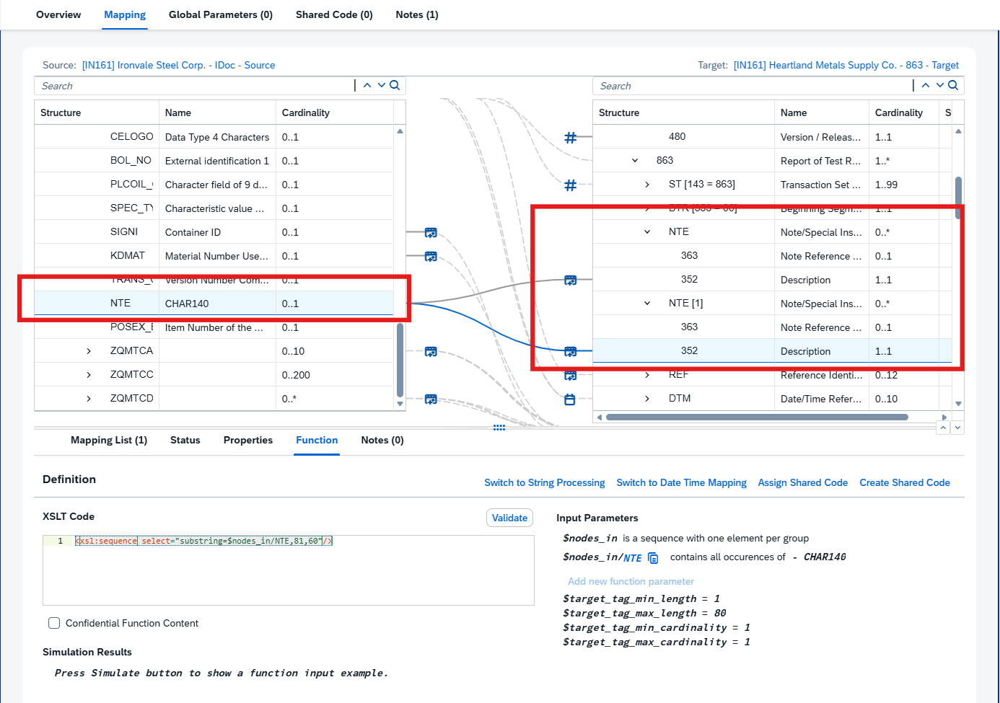
In the mapping editor, locate the target field in the X12 863 that needs a transformation Element **352** _[/Interchange/FunctionalGroup/863/NTE/352]_ 
(for example, the field that should hold a Note/Special Instruction). Select the corresponding Source element by clicking on it from the IDoc structure which would be **NTE** _[/ZEDI863/ZQMTCSHPHDR/ZQMTCHDR/NTE]_ field to see the element details. 

| Mapping Element | Prompt | Expected output  |
|-----------------|--------|------------------|
| : ZEDI863/ZQMTCSHPHDR/ZQMTCHDR/NTE to /Interchange/FunctionalGroup/863/NTE/352 | Create an XPath 2.0 that outputs from $nodes_in/NTE all characters from the 1st to the 80th character.   | <xsl:sequence select="substring($nodes_in/NTE, 1, 80)"/>  |
| : ZEDI863/ZQMTCSHPHDR/ZQMTCHDR/NTE to /Interchange/FunctionalGroup/863/NTE[1]/352 | Create an XPath 2.0 that outputs from $nodes_in/NTE all characters from the 81st to the 140th character.  | <xsl:sequence select="substring($nodes_in/NTE, 81, 60)" |

----
**Set Conditions at a Leaf Node**  
You can set conditions at a group node or leaf node. A condition is used to write a node into the target  
payload under specific circumstances expressed by the condition. The leaf node condition feature especially has the advantage that you must put all the condition complexity into the mapping function. This is separated and makes the mapping function much more straigthforward.
1) If you need a condition at  the leaf node, follow the  following steps:
2) Check which leaf nodes you need a condition for. We prepared ones below.
3) Click on the chosen target node, **93[2]** _[/Interchange/FunctionalGroup/863/N1 [98 = SH]/N2/93 [2]_] because this should be generated, if the input string from node **NAME1**_/ZEDI863/ZQMTCSHPHDR/ZQMTCHDR/ZQMTCADRC/NAME1_ is longer than 35 characters, these remainaing characters will be written into the leaf node **92[2]**. 
   

4) Go the mapping list.
5) Enable the "Condition" by selecting the empty checkbox
6) The Tab "Condition" is visible, open it and enter the specific condition. 
        _["boolean(string-length($nodes_in/NAME1[1]) > 35)"]_ 
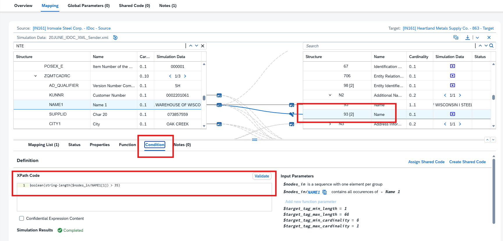

7) Enable this as shared condition. Enter A name "Name2" and a Description "Long Name Condition". 
       You will see that in the Shared Code Tab beside "Global Parameters" you have now 1 entry. You can reuse this condition on the second instance of the node 93 of N2 in the group of N1 [98 = SO]. 
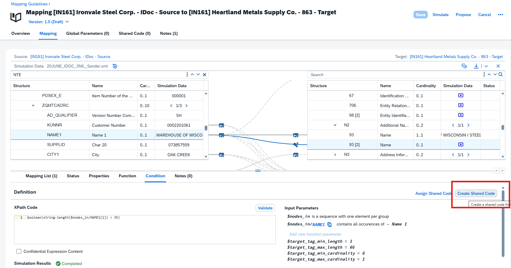

8) Navigate to the element **93[2]** under the Element **N2** of **N1[98=SO]** _[/Interchange/FunctionalGroup/863/N1 [98 = SO]/N2/93 [2]]_ and assign the shared Code Condition by enabling again the Condition from the Mapping List, navigate to the Condition Tab and Select "Assign Shared Code" Select "Name2" and Save your chnages. 
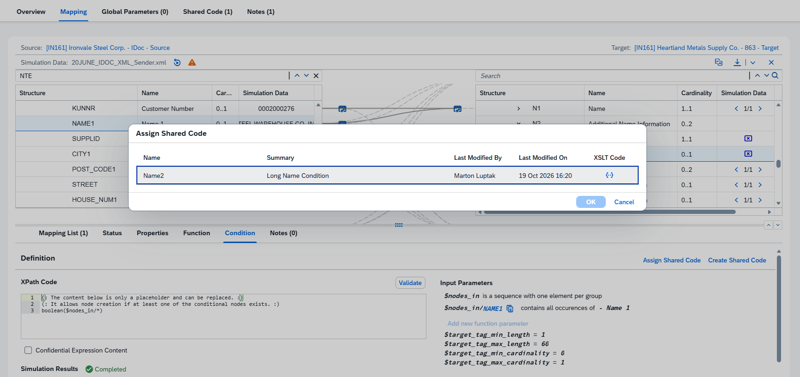

9) Select Simulate option to verify if your changes saved properly and get results in the Simulation Data Tab. 
(In case you ran the simulation before, rerun the simulation again)

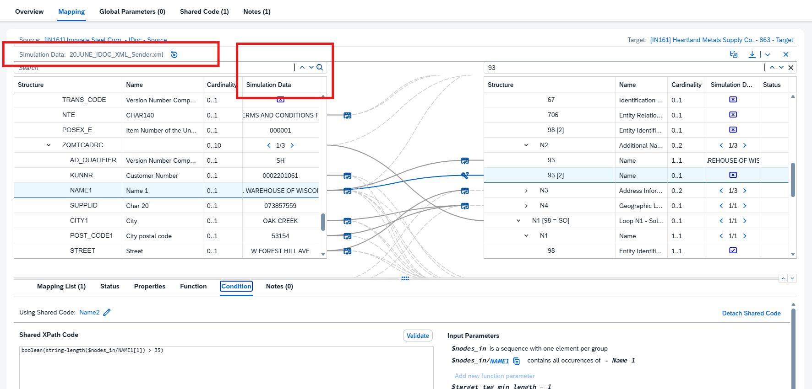

----

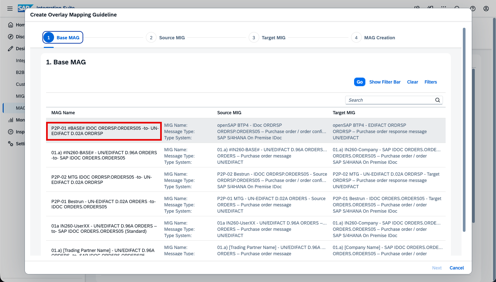
Open _Joule_ from the mapping editor.

----

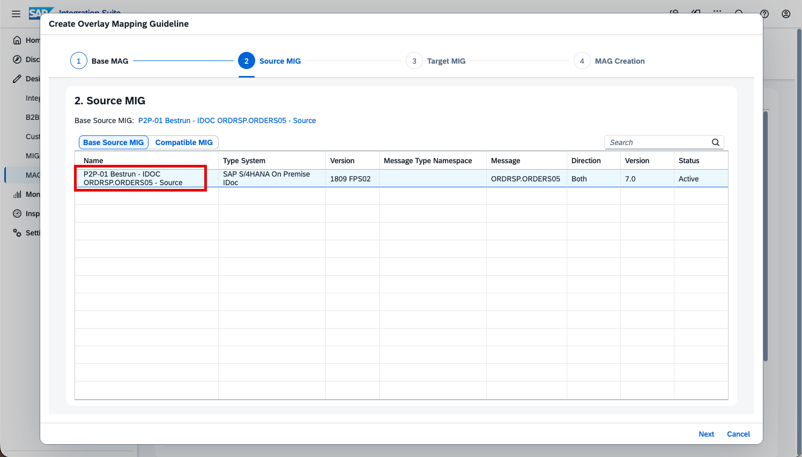
Describe the transformation you need in plain language, for example:

> "Concatenate the measured value and its unit of measure, separated by a space, and return the result as a single string."

Then let Joule generate the mapping function.

----

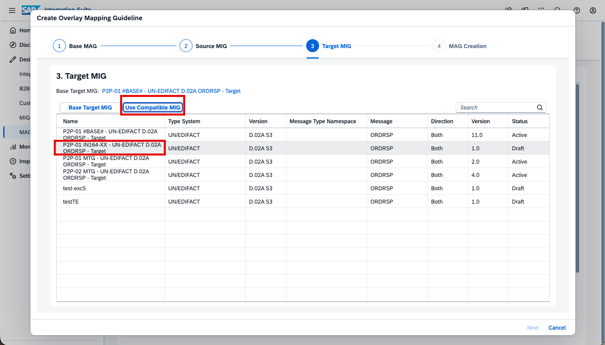
Review the mapping function that Joule proposes. Check that it uses the correct source fields and produces the expected output. If it is not quite right, refine your description and let Joule regenerate it.

----

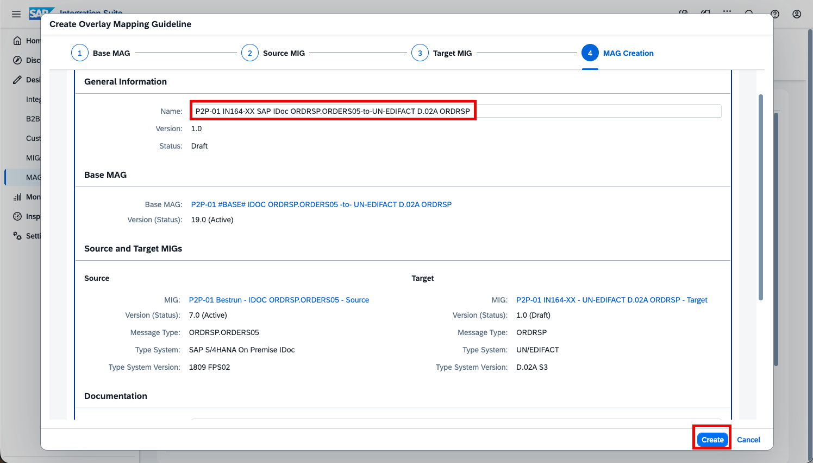
Apply the generated function to the target field, then test it with example values to confirm the output is correct.

----

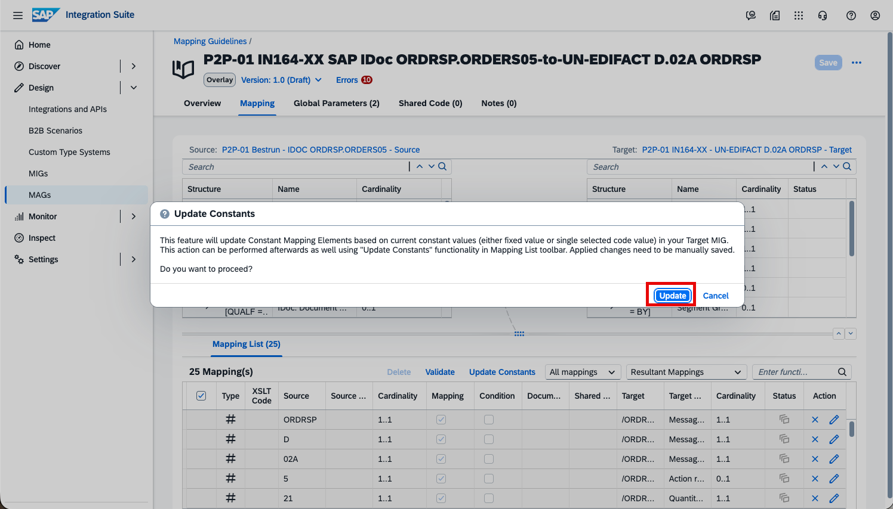
Optionally, repeat the process for another transformation – for example, ask Joule to map an internal steel-grade code to the trading partner's code, or to convert the unit of measure.

----

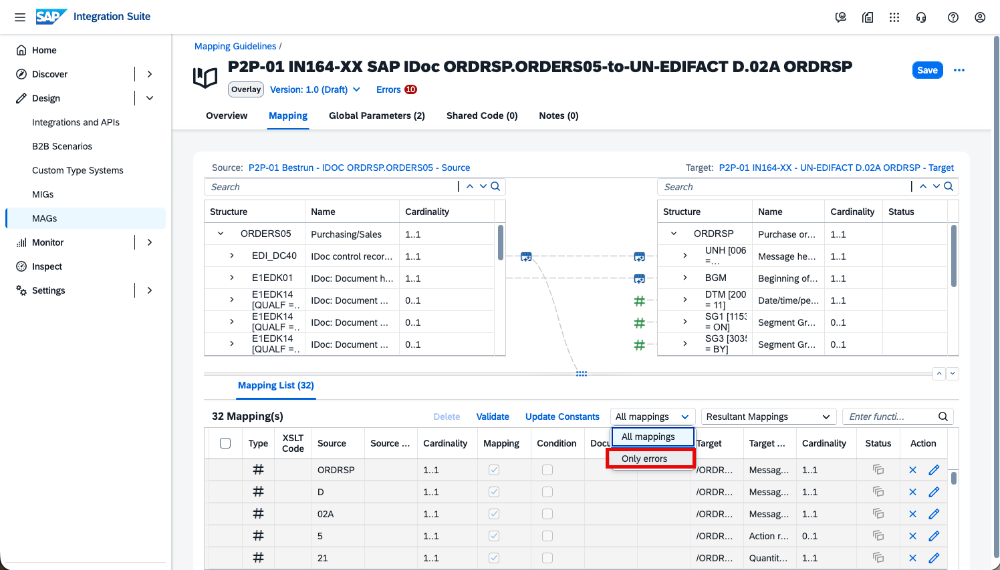
When you are satisfied with the result, click _Save_ to store your MAG.

----

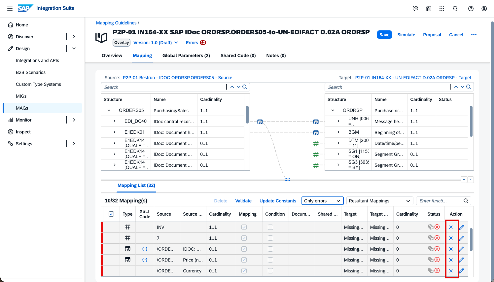
Your MAG is already assigned to your Quality Certificate-UserXXX agreement from Exercise 5, so you only need to make the new version effective: open the agreement, click _Save_ and then _Update_ to write the changes to the Partner Directory. Wait until the agreement returns to _Active_.

----

Send a test message: go to Design -> Integrations and APIs -> IN161-UserXXX, open _Artifacts_, and click _More_ (...) -> _Deploy_.

----

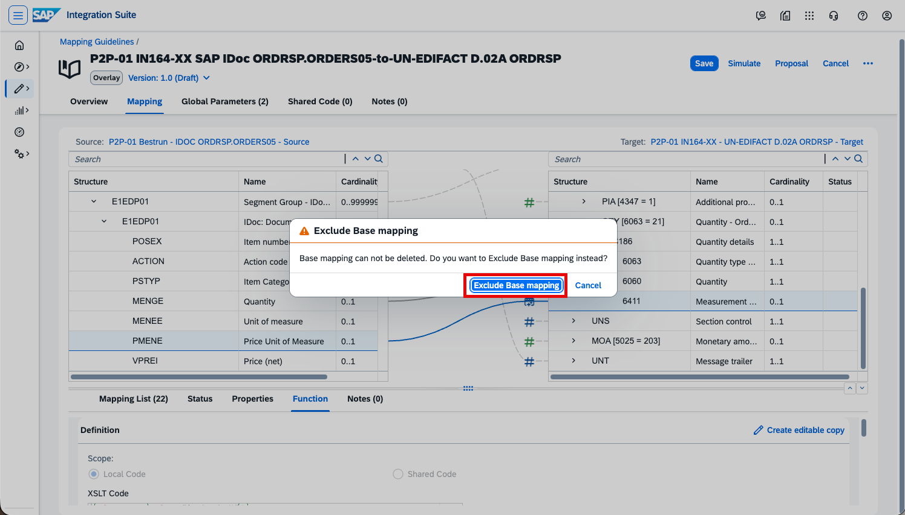
Go to Monitor -> B2B Scenarios -> Interchanges, click _Go_, and open your outbound interchange. In the generated ANSI X12 863 message, confirm that the fields handled by your Joule-generated mapping functions now contain the expected, transformed values.

----

Continue with: [Exercise 7 - (Bonus) Work with the functional acknowledgment](Exercise-7.md)

Please give us feedback for this session **IN161**

