# IN161 - Exercise 6 - Create your own Mapping Guideline (MAG) using proposals

## Overview
Until now, your agreement has used the mapping that was **migrated from PI/PO** and was already available in the tenant. That is the fastest way to go live, but you often want to own and evolve the mapping yourself in Integration Advisor.

In this exercise you will create your **own Mapping Guideline (MAG)** that maps the SAP IDoc **ZQMOUTTC** (quality certificate) to **ANSI X12 863** (Report of Test Results, version 004010). Instead of mapping every field by hand, you will let the Integration Advisor **knowledge base propose** the mapping for you. Finally, you will plug your new MAG into your Copy agreement, send a message, and verify the result in the B2B Monitor.

The source and target Message Implementation Guidelines (MIGs) already exist in the tenant:
- Source MIG: _[IN161] Ironvale Steel Corp. - IDoc - Source_
- Target MIG: _[IN161] Heartland Metals Supply Co. - 863 - Target_

As usual, replace XXX with your participant number wherever it appears.

> Note: The exact MIG/MAG names above are tenant-specific – please verify them against your tenant.

----

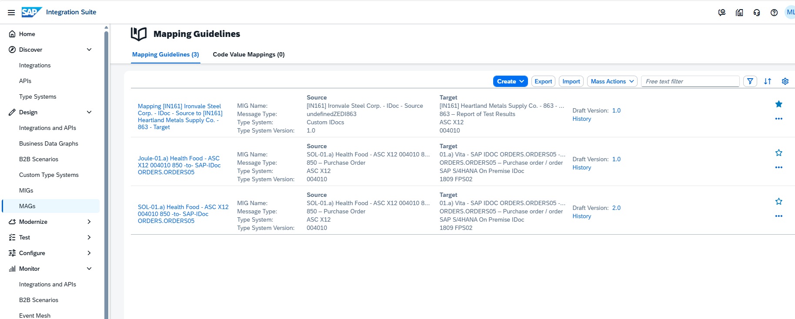

In the left-hand navigation, go to Design -> MAGs.

----

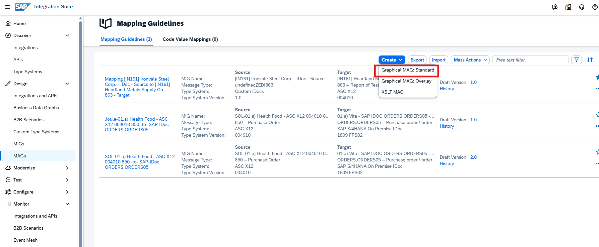

Click Create -> Graphical MAG:Standard.

----

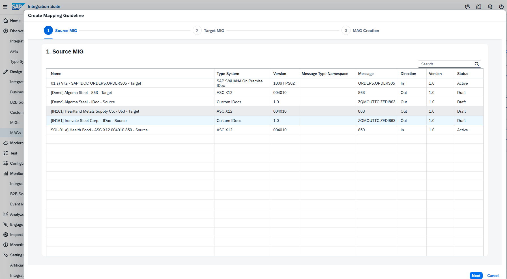

Select the source MIG: [IN161] Ironvale Steel Corp. - IDoc - Source

----

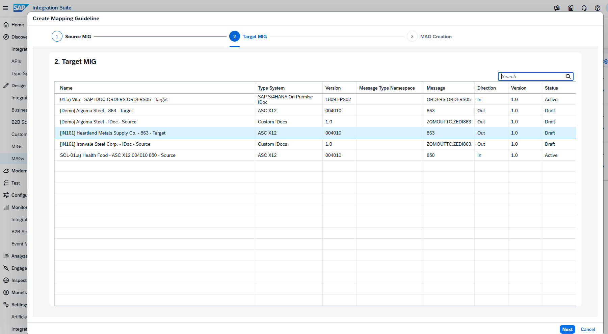

Select the target MIG: [IN161] Heartland Metals Supply Co. - 863 - Target

----

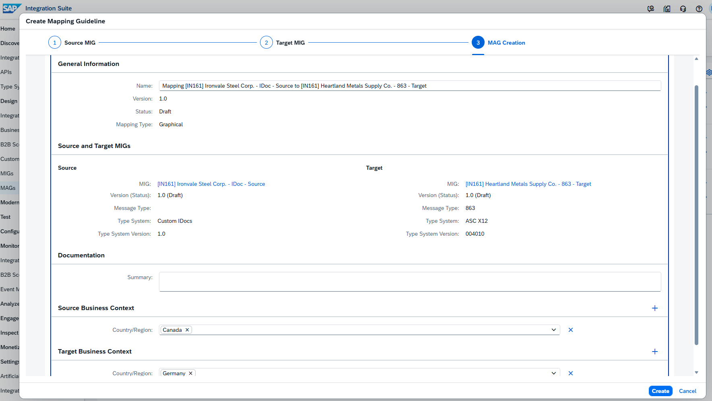

Enter the MAG name using the following naming scheme: Mapping [IN161] UserXXX IDoc - Source to 863 - Target (replace XXX with your number), then click Create.

----

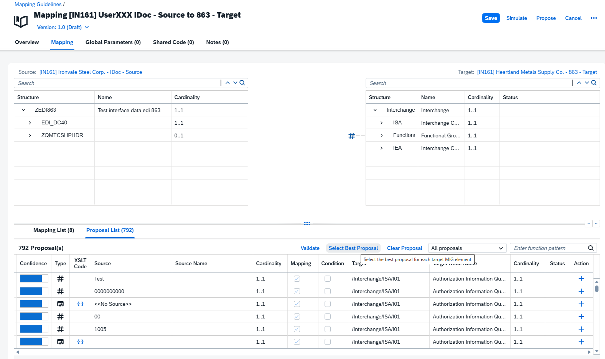

Your new MAG opens in the mapping editor. It is still empty – no fields are mapped yet. To accelerate the mapping of the source to target elements and avoid mapping everything manually, request a proposal from the knowledge base: click Propose in the upper-right corner next to the Simulate button.

----

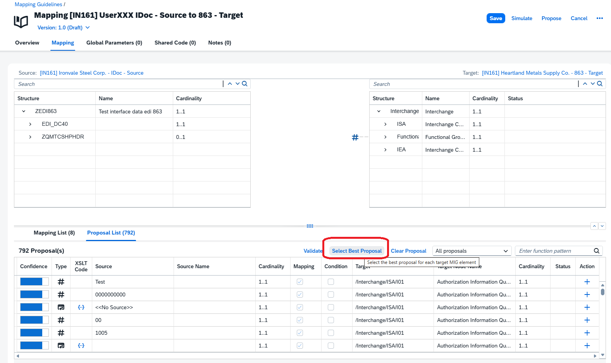

To automatically apply the proposal with the highest confidence, click Select Best Proposal in the Details section at the lower part of the screen, next to the Validate button.

----

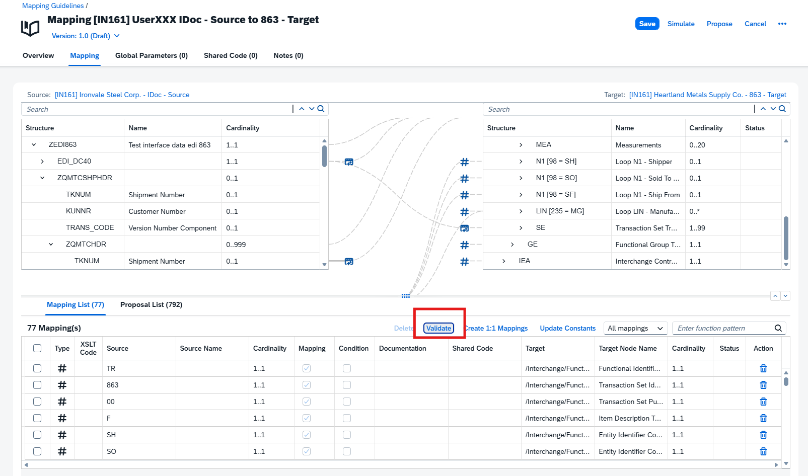

Because the knowledge base can include mapping functions that may not work in your context, click Validate in the Details section to ensure only valid mapping elements/function snippets are used.

----

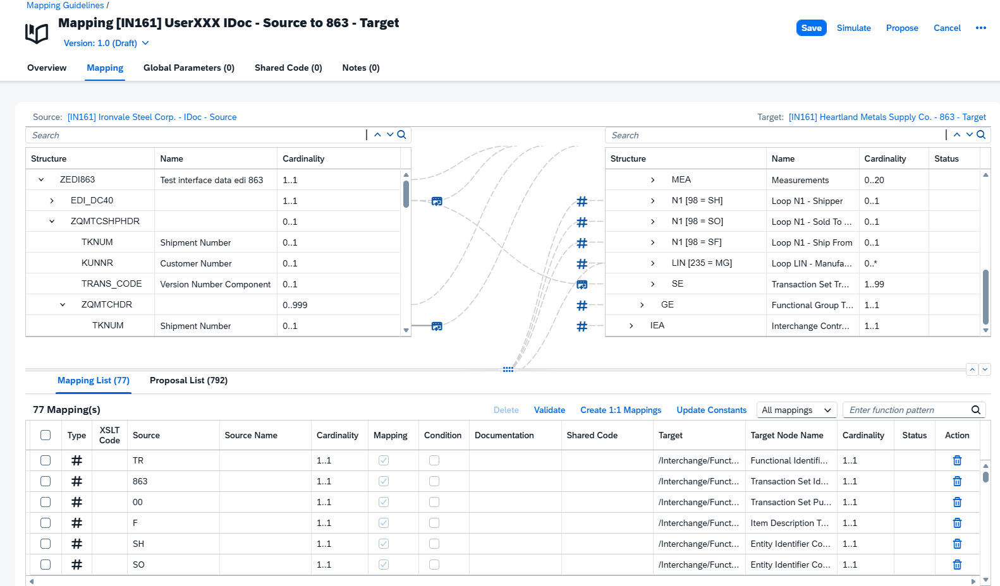

Review the proposed mappings. The knowledge base maps the quality-relevant fields (for example, inspection/test values and their units) from the ZQMOUTTC structure to the corresponding ANSI X12 863 segments. Then click Save.

----

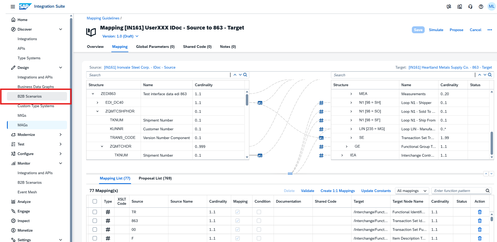

Now use your new MAG in your agreement. Go to B2B Scenarios in the left-hand navigation under Design and go to -> Agreements and open your agreement Quality Certificate-UserXXX. It should be Active from the previous exercise.

----

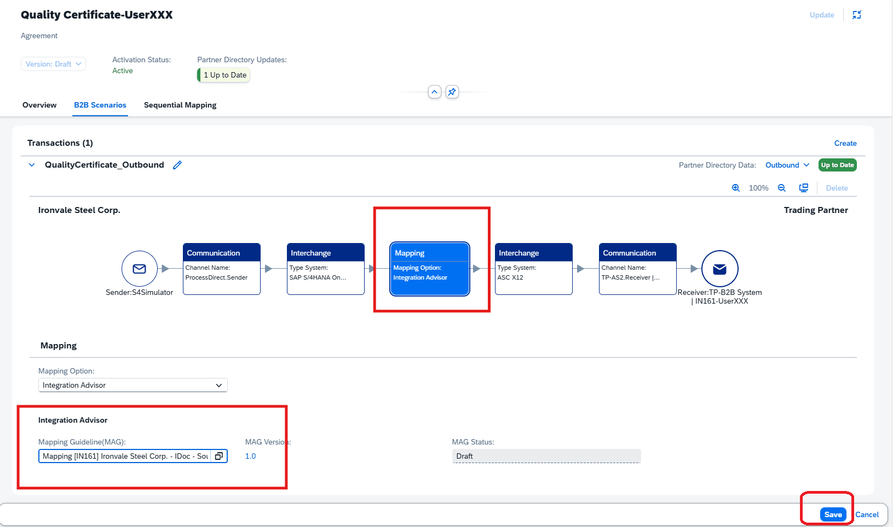

Switch to the B2B Scenarios tab and set the B2B Scenario to Edit mode. In the QualityCertificate_Outbound transaction flow:
- Click the Mapping box.
- In the details pane, click the Mapping field to open the selection dialog.
- Search for your MAG Mapping [IN161] UserXXX IDoc - Source to 863 - Target and select it, then click Choose. If you do not find your MAG, click Reset to see all the available MAGs from Integration Advisor.

----

Click Save on the agreement, then click Update to write the changes to the Partner Directory. Wait until the agreement returns to Active.

----

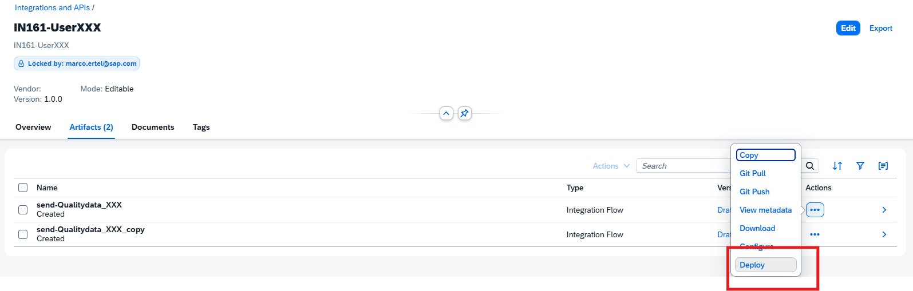

Send a test message: go to Design -> Integrations and APIs -> IN161-UserXXX, open Artifacts, click the three dots (...) -> Deploy. Then go to Monitor -> B2B Scenarios -> Interchanges, click Go, and open your outbound interchange to confirm the ANSI X12 863 message was produced by your own MAG.

----

Continue with: [Exercise 7 - Enhance the mapping with Joule](Exercise-7.md)

Please give us feedback for this session **IN161**

