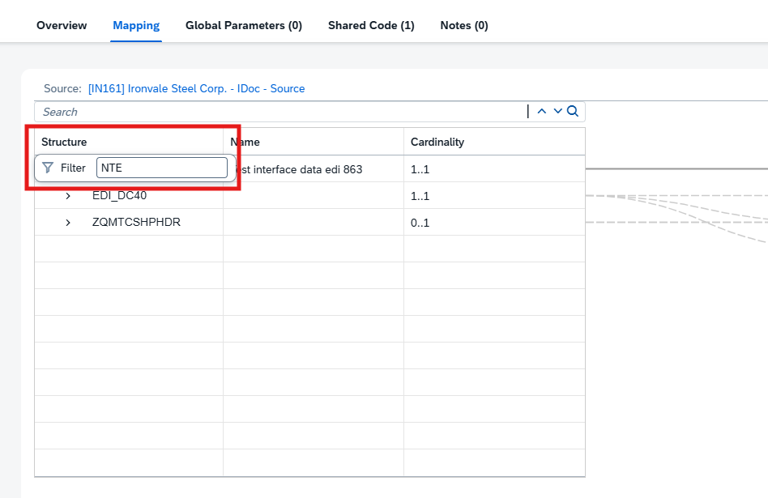
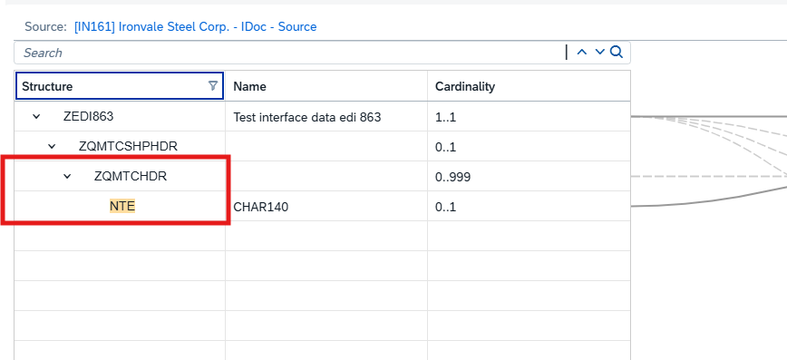
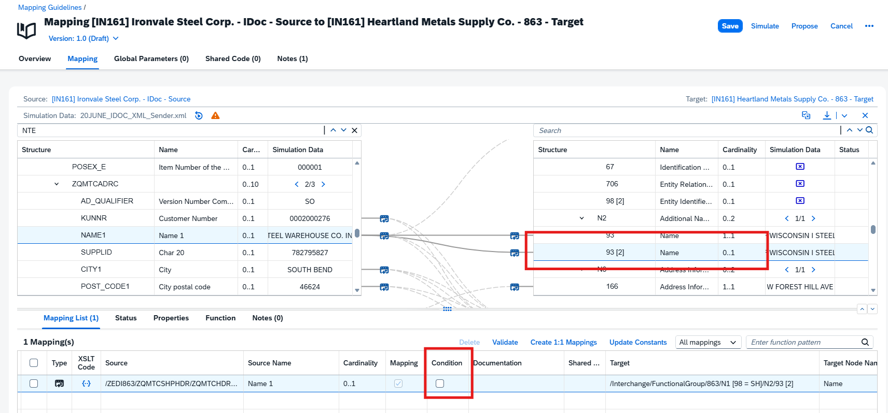
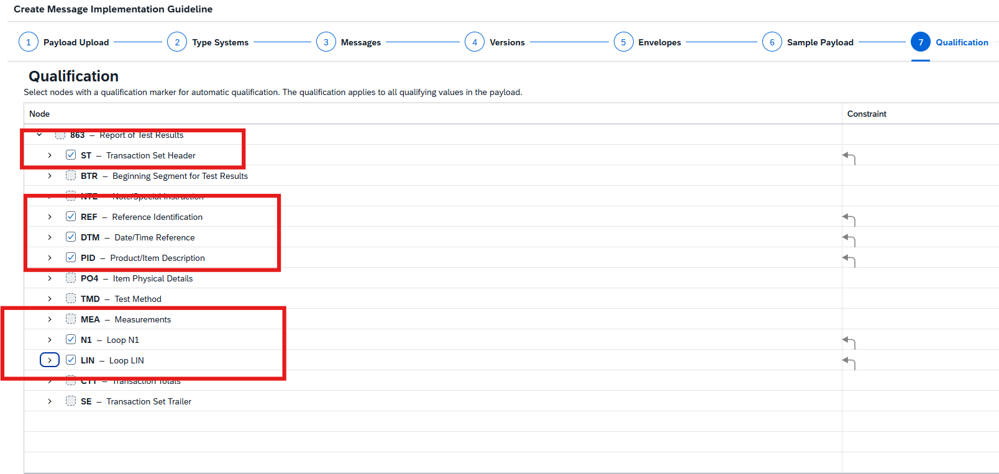
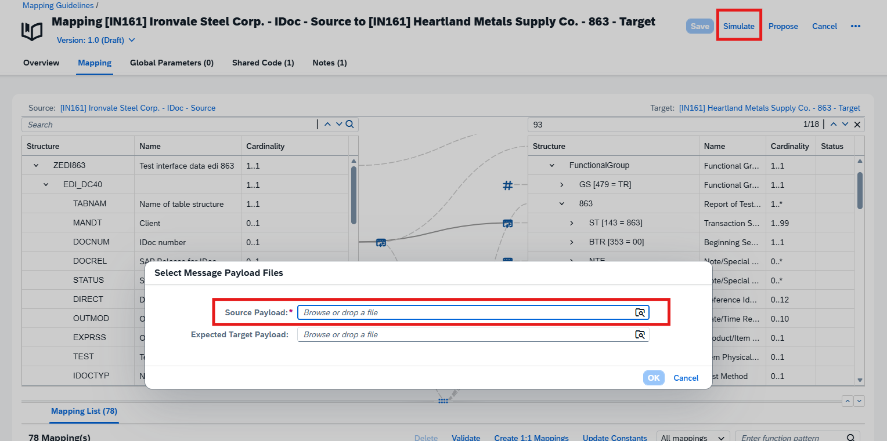

# IN161 - Exercise 7 - Enhance the mapping guideline(MAG)

## Overview

**Prerequisite**:   
Download the source payload for the simulation steps: [IDoc_Sample_Payload](Payload/IDoc_Sample_Payload.txt) 

Your MAG from Exercise 6 covers the mandatory field mappings like date conversions, one-to-one mappings from the knowledge base proposal. Additionally to the proposed mapping elements there could be more complex conditional mappings with functions require adjustments. In the example of this ANSI X12 863 message we need transformations with conditional rules to consider test values, units, and material grades need to be reformatted or translated to the partner's conventions.

 In this exercise this applies to finding the  corresponding source and target nodes that are semantically equivalent and creating complex functions if the values cannot be copied from the source side to the target side. To accelerate this, you will use **built-in helper features** to create such **mapping functions**.

Typical examples in our Report of Test Results scenario:
- Split a long note/instruction text across two target fields using substring functions (NTE → 863/NTE/352).
- Strip a leading house number from a street address using a regular-expression replace (STREET → N3/166).
- Write an overflow name segment conditionally when the source name exceeds 35 characters (NAME1 → N2/93[2]).
- Reformat a phone/fax number by removing hyphens and prepending a country code (FAX → PER/364).

As usual, replace XXX with your participant number wherever it appears.

----
Several more straight forward mapping functions transform the input from one node into a specific value of one target node. The logic of some of the functions is recognizable.
For example, truncate, split or concatenate the input string's first or second part and write the remaining part into the output. You’ll find the list of the mapping elements with such mapping functions below.  

In the left-hand navigation, go to Design -> MAGs and open your MAG from the previous exercise: _QMapping [IN161]  UserXXX IDoc - Source to 863 - Target_ (replace XXX with your number).

----

 
In the mapping editor, locate the target field in the X12 863 that needs a transformation Element **352** _[/Interchange/FunctionalGroup/863/NTE/352]_ 
Select the Element and navigate to the Action in the column with 3 dots **...**. Click the action button **Duplicate**.  
 

(for example, the field that should hold a Note/Special Instruction). Select the corresponding Source element by clicking on it from the IDoc structure which would be **NTE** _[/ZEDI863/ZQMTCSHPHDR/ZQMTCHDR/NTE]_ field to see the element details. 

You could use the **Structure column** to filter for the element. To do so navigate to the Source Or Target Message above the root element and click the "Structure" column and filter the element  **NTE**.
 

After that you should see the element details by clicking on the source or target element. In the lower part of the Mapping Editor the details of the mapped element should appear, eg. in the **Function** tab with the XSLT Editor.
  

The required mapping rules could vary based on the given requirements of the mapping specification of the business requirements. In the table below you see some example what could be designed via the XSLT Function. The built-in proposal service may already propose you even basic or complex functions used at this element/node. In case you do not have a proposal for the selected element you want to map you can use the built-in XSLT Editor to generate the functions and validate of it´s correctness with it. 
Teaser: The accelerated help of XSLT functions/ xPath Expressions via artificial intelligence coming soon where you could manage the mappings even faster. 

[Roadmap: XPATH and XSLT generation in MAG](https://roadmaps.sap.com/board?PRODUCT=73554900100800003241&range=CURRENT-LAST#;INNO=139C4BD172041EDFA78AA7D751B3120A)

| Mapping Element | Requirement| XPath expression |
|-----------------|--------|------------------|
| : ZEDI863/ZQMTCSHPHDR/ZQMTCHDR/NTE **to** /Interchange/FunctionalGroup/863/NTE/352 | I need an XPath 2.0 that outputs from $nodes_in/NTE all characters from the 1st to the 80th character.   | <xsl:sequence select="substring($nodes_in/NTE, 1, 80)"/>  |
| : ZEDI863/ZQMTCSHPHDR/ZQMTCHDR/NTE **to** /Interchange/FunctionalGroup/863/NTE[1]/352 | Create an XPath 2.0 that outputs from $nodes_in/NTE all characters from the 81st to the 140th character.  | `<xsl:sequence select="substring($nodes_in/NTE, 81, 60)"/>` |

*Save* your changes. You can run a simulation with the given Payload for the Source Structure to verify the results or you can also run a simulation with the Example Data of the MIG. 

----
Let´s take an other example for a mapping function transformation. You can define a truncate function to consolidate the input structure you want to have mapped to the target. To do so navigate to the Element **166** under **N3** in the target X12 structure and use the following function in the table: 
In case you do not get a mapping line via the proposed elements between source and target you need to take the Source node to the Target Node element by drawing a line to be able to include the mapping logic.  

| Mapping Element | Requirement| XPath expression |
|-----------------|--------|------------------|
| :  /ZEDI863/ZQMTCSHPHDR/ZQMTCHDR/ZQMTCADRC [AD_QUALIFIER = SH]/STREET **to** /Interchange/FunctionalGroup/863/N1 [98 = ST]/N3/166 | Create an XPath 2.0 that truncates the house number from the input $nodes_in/STREET if the house number is at the beginning and is just based on numbers.  | `<xsl:sequence select="replace($nodes_in/STREET,'^\d+\s','')"/>` |

*Save* your changes. You can run a simulation with the given Payload for the Source Structure to verify the results or you can also run a simulation with the Example Data of the MIG. 

----

Let´s go into more functions which you could also easily manage via the Mapping Editor. 

**Set Conditions at a Leaf Node**  
You can set conditions at a group node or leaf node. A condition is used to write a node into the target  
payload under specific circumstances expressed by the condition. The leaf node condition feature especially has the advantage that you must put all the condition complexity into the mapping function. This is separated and makes the mapping function much more straightforward.
1) If you need a condition at  the leaf node, follow the  following steps:
2) Check which leaf nodes you need a condition for. We prepared ones below.
3) Click on the chosen target node, **93[2]** _[/Interchange/FunctionalGroup/863/N1 [98 = ST]/N2/93 [2]_] because this should be generated, if the input string from node **NAME1**_/ZEDI863/ZQMTCSHPHDR/ZQMTCHDR/ZQMTCADRC/NAME1_ is longer than 35 characters, these remaining characters will be written into the leaf node **93[2]**. 
    

4) Go the mapping list.
5) Enable the "Condition" by selecting the empty checkbox
6) The Tab "Condition" is visible, open it and enter the specific condition. 
        _["boolean(string-length($nodes_in/NAME1[1]) > 35)"]_ 
 

7) Enable this as shared condition. Enter A name **"Name2"** and a Description "Long Name Condition". 
       You will see that in the Shared Code Tab beside "Global Parameters" you have now 1 entry. You can reuse this condition on the second instance of the node **93** of **N2** in the group of **N1 [98 = SE]**. 
 

8) Navigate to the element **93[2]** under the Element **N2** of **N1[98=BY]** _[/Interchange/FunctionalGroup/863/N1 [98 = BY]/N2/93 [2]]_ and assign the shared Code Condition by enabling again the Condition from the Mapping List, navigate to the Condition Tab and Select **"Assign Shared Code"** Select **"Name2"** and Save your changes. 
 

9) Select Simulate option to verify if your changes saved properly and get results in the Simulation Data Tab. 
(In case you ran the simulation before, rerun the simulation again)
 

 

Optionally, repeat the process for another transformation of your choice, for example define a concatenation, splitting, or replacing fax/phone numbers.

| Mapping Element | Requirement| XPath expression |
|-----------------|--------|------------------|
|:/ZEDI863/ZQMTCSHPHDR/ZQMTCHDR/ZQMTCADRC [AD_QUALIFIER = SO]/FAX  **to**   /Interchange/FunctionalGroup/863/N1 [98 = BY]/PER/364 [365 = FX] | Create an XPath 2.0, expression, where the input is a number with hyphens which need to be removed and set a country code 00 before the first number|  `<xsl:sequence select="concat('00', translate($nodes_in/FAX, '-', ''))"/>` |
  

**Save** your changes and simulate the results with the given payload. 

----

Continue with: [Exercise 8 - (Bonus) Duplicate and retry an interchange](Exercise-8.md)

Please give us feedback for this session **IN161**

