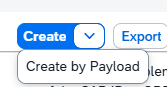
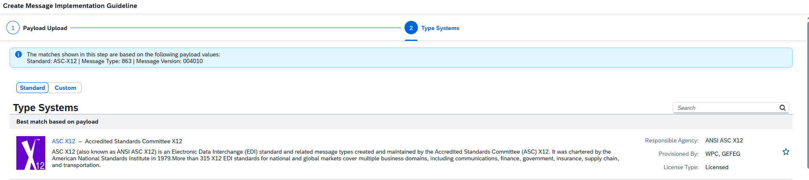
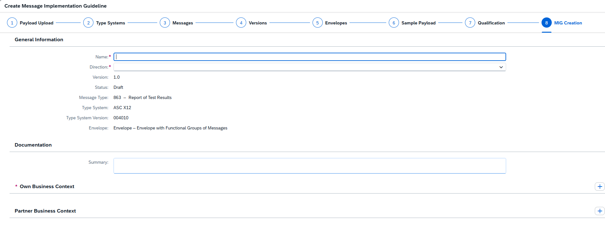
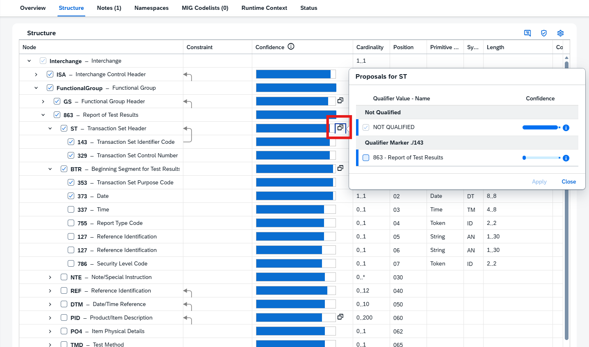
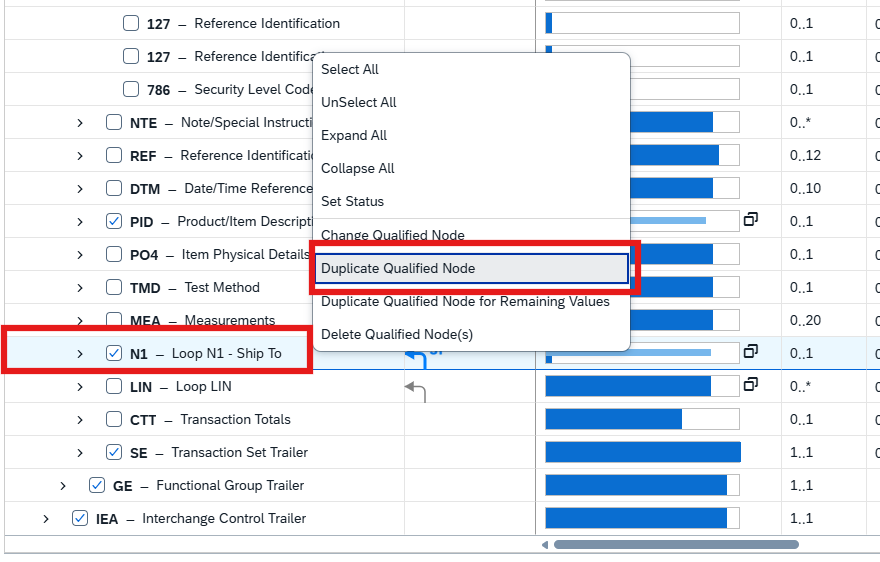

# IN161 - Exercise 5 — (Optional) Create Target Message Implementation Guideline(MIG)

## Overview
In this exercise you will create the Trading Partner specific Target MIG.  
Prerequisite: Payload _XYZ X12 863.edi_ (download from the Payload Folder)  
Goto Message Implmenentation Guidelines Overview screen, Select in the Create button dropdown the "Create by Payload" option.  
Drop in or select the prepared Payload and navigate through the guided steps by confirming the proposed selection for the X12 Type System, 863 Message, with the selected Version of 004010 . 

 

Select Envelope, and navigate to the "Sample Payload" selection Step.
 

Select all offered options inlcuding "Set Example Values" as indicated by the Screenshot
 

Go to the Qualification step and select the nodes as indicated by the Screenshot
 

Hit the Create button on the lower right corner. The MIG Creation Dialog opens where you need to specify the Name and Direction of the MIG as well the Business Context Information. 
Specify: 
 	MIG Name: "UserXXX - 863 - Target MIG (replace XXX with your number) 
 	Direction : Out 
Own Business Context: Select Country Germany ( 1 would be enough...) 
 

Navigate the the Second Tab called "Structure" and select the "Get Proposal" button from the right upper corner. 
  

In the Structure you will see a new Column called "Confidence" with blue bars and beside selected Nodes like **ST** under **863** selection button 
Navigate to the node **ST** select the two boxes action and select the proposed Qualification Value _863_ to qualify the **ST** Segement from the Element **143** _Transaction Set Identifier Code_. This qualification is constant value which will be automatically taken over at the Mapping Excercise.
  
     

Navigate to the Element **BTR** select the two boxes action and select the proposed Qualification Value _00_
  

Navigate to the Element **PID** select the two boxes action and select the proposed Qualification Value _F_
  

Navigate to the Element **N1** select the two boxes action and select the proposed Qualification Value _ST_
 

A qualified Element of **N1** was created with the qualified value _ST_. We need to have multiple **N1** Segments as such we need to qualify 2 additional elements with the qualified value _SE_ For the Selling Party and _BY_ for the Buyer Party. This qualification enables a direct mapping of the source elements from the IDoc structure to the Target structure without any additional functional mapping steps. 
To qualify another Enumreation Value for the **N1** Segment we will duplicate the Node by selecting the qualified **N1** right Mouse click and select from the action _"Duplicate Qualified Node"_ with the value _"SE"_ as indicated on the screenshot. 

We do the same for the newly created qualified **N1** node as before as such duplicate the Node by selecting the qualified **N1** right Mouse click and select from the action _"Duplicate Qualified Node"_ and select the _"BY"_

Next navigate to the Element **DTM** right mouse click and select _"Qualify Node..."_ 

Select the Value _"050"_ from the Enumeration lsit and click **"Create"** to qualify the **DTM** segment. 

Once you verified the actions you can filter out the selected Elements. Navigate to the Filter of the First Column **Node** and set a filter to _"Show Selected Nodes"_

Save your changes! 

Congratulations — you have finished the TechEd exercise!

Please give us feedback for this session **IN161**

