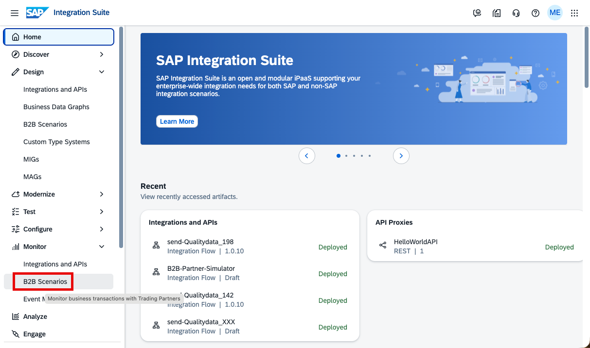
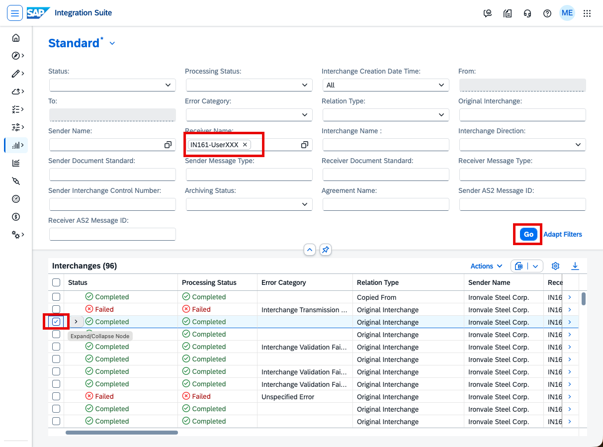
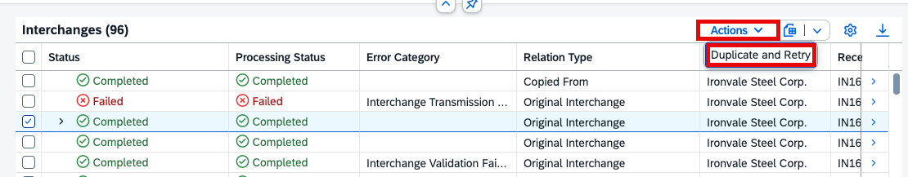
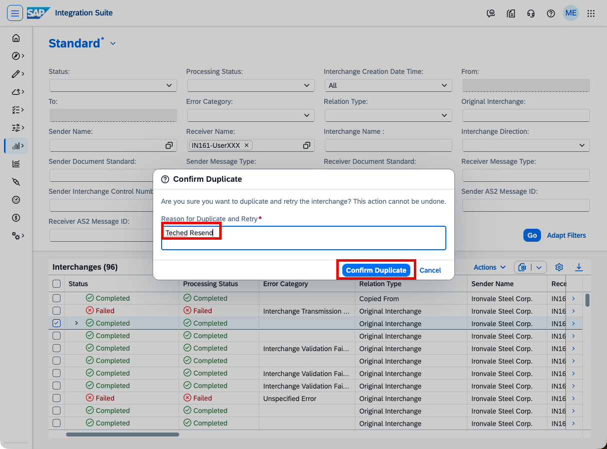
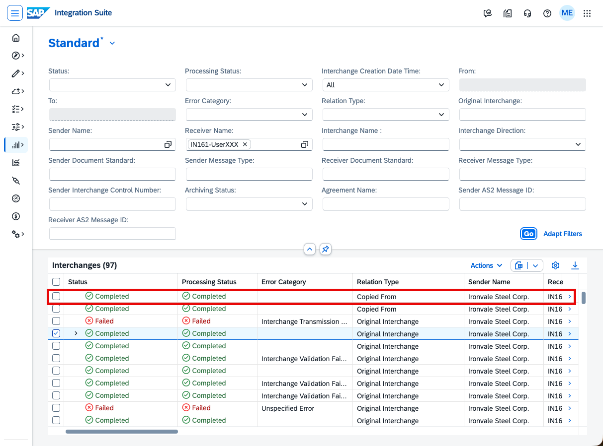
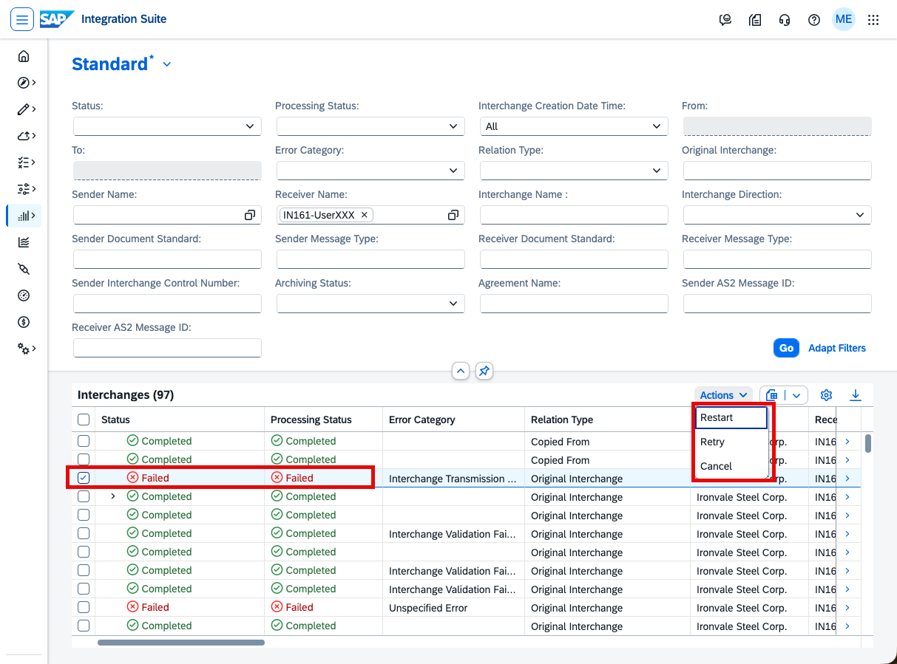

# IN161 - Exercise 8 — (Bonus) Duplicate and retry an interchange

## Overview
Sometimes a message has to be processed **again**. This is a general capability of Trading Partner Management and applies to any interchange, not only the X12 863 you worked with in this workshop. In the B2B Monitor, Trading Partner Management offers an **Actions** menu on an interchange with three options – **Restart**, **Retry**, and **Duplicate and Retry** – and it is important to understand that they do **not** do the same thing and apply to **different** interchange states:

- **Restart** (status **Failed** only) resets the sender payload to the beginning of the integration flow, so the **message mapping is re-executed**. Use it for errors in message transformation or formatting (the mapping itself needs to run again).
- **Retry** (status **Failed** only) resets the receiver payload to the receiver communication step and **bypasses the mapping**. Use it for receiver-side problems or temporary connectivity issues – for example, when the receiving system was down – where the original mapping is still valid.
- **Duplicate and Retry** (status **Completed** only) creates a **copy** of the interchange as a **new** interchange and processes that copy. The **original interchange is untouched** – it keeps its status and processing history, and only gets an event/note noting that it was duplicated.

In this exercise your earlier interchanges completed successfully, so **Restart** and **Retry** (which target failed messages) do not apply. Instead you will take one of your **Completed** outbound interchanges and run **Duplicate and Retry**, so you can see that a duplicate is sent as a new interchange while the original stays as it was.

More information: [Restart or Retry, or Duplicate and Retry Interchanges](https://help.sap.com/docs/integration-suite/isuite-trading-partner-management/restart-retry-interchanges)

> Note: Reprocessing requires a reprocess destination (B2BTPM_Reprocess_Endpoint) to be configured in the tenant. For this workshop it is already set up for you. If the Actions menu is not available, ask your trainer.

As usual, replace XXX with your participant number wherever it appears.

----

In the left-hand navigation, go to Monitor -> B2B Scenarios and open the Interchanges tile.

----

Filter by your Receiver Name IN161-UserXXX and click Go. From the previous exercises you should see one or more outbound interchanges with status Completed. Select one of them in the list by ticking its checkbox – this enables the Actions button.

----

Click Actions. Because your interchange is Completed, the only available action is Duplicate and Retry – Restart and Retry are reserved for interchanges in status Failed. Choose Duplicate and Retry to send a copy of this completed interchange as a new interchange.

----

In the Confirm Duplicate dialog, enter a reason in Reason for Duplicate and Retry (for example, Teched Resend) and click Confirm Duplicate.

> Note: This action cannot be reversed and can take a while to complete.

----

Click Go to refresh the Interchanges list. A new outbound interchange now appears at the top with Relation Type Copied From. Your original interchange is still there, unchanged, with Relation Type Original Interchange – confirming that Duplicate and Retry creates a copy rather than changing the original.

----

To see the difference, look at a Failed interchange: when you select one and open Actions, it offers Restart and Retry instead of Duplicate and Retry. Keep the distinction in mind:

- **Restart** (Failed only) – re-runs processing from the start, so the **mapping is executed again**; use it for mapping/formatting errors.
- **Retry** (Failed only) – re-runs from the receiver step and **skips the mapping**; use it for receiver-side or connectivity errors (for example, the receiver was down).
- **Duplicate and Retry** (Completed only) – creates and processes a **duplicate** as a new interchange; the original is left unchanged.

Congratulations — you have finished the TechEd exercise!

Please give us feedback for this session **IN161**. Scan the QR code to open the mobile app, then navigate to this session (IN161) to give your feedback.

